# Robustness Under Attack: Assessing Adversarial Fragility in Deep Learning Models for COVID-19 Radiography Prediction

<div align="center">


**Official Research Repository & Technical Documentation**  
**Department of Informatics Engineering — Faculty of Engineering**  
**Universitas Muhammadiyah Malang (UMM)**

[](https://doi.org/10.35882/jeeemi.v8i2.1506)
[](journal/journal-1506-Article%20Text-8082-1-10-20260428.pdf)
[](notebooks/covid19_xray_adversarial_robustness.ipynb)

</div>

---

## Table of Contents

1. [Publication Overview & Research Team](#1-publication-overview--research-team)
2. [Abstract & Core Scientific Contributions](#2-abstract--core-scientific-contributions)
3. [Clinical Background & Problem Formulation](#3-clinical-background--problem-formulation)
4. [Dataset & Preprocessing Pipeline](#4-dataset--preprocessing-pipeline)
5. [System Architecture & Mathematical Methodology](#5-system-architecture--mathematical-methodology)
6. [Experimental Results & Quantitative Analysis](#6-experimental-results--quantitative-analysis)
7. [Grad-CAM Interpretability: Semantic Decoupling vs. Semantic Inversion](#7-grad-cam-interpretability-semantic-decoupling-vs-semantic-inversion)
8. [Defense Recommendations & Future Directions](#8-defense-recommendations--future-directions)
9. [Technology Stack & Repository Structure](#9-technology-stack--repository-structure)
10. [Installation, Reproduction & Documentation Guide](#10-installation-reproduction--documentation-guide)
11. [Citation, References & License](#11-citation-references--license)

---

## 1. Publication Overview & Research Team

This repository provides the complete source code, experimental execution logs, high-resolution visualizations, and technical documentation accompanying the peer-reviewed research article published in the **Journal of Electronics, Electromedical Engineering, and Medical Informatics (JEEEMI)**:

| Attribute | Details |
|:----------|:--------|
| **Article Title** | *Robustness Under Attack: Assessing Adversarial Fragility in Deep Learning Models for COVID-19 Radiography Prediction* |
| **Journal** | *Journal of Electronics, Electromedical Engineering, and Medical Informatics (JEEEMI)* |
| **Volume / Issue / Pages** | Vol. 8, No. 2, April 2026, pp. 769–788 (e-ISSN: 2656-8632) |
| **Digital Object Identifier (DOI)** | [https://doi.org/10.35882/jeeemi.v8i2.1506](https://doi.org/10.35882/jeeemi.v8i2.1506) |
| **Manuscript Timeline** | Received: 27 January 2026 · Revised: 10 March 2026 · Accepted: 16 April 2026 · Available Online: 26 April 2026 |
| **Affiliation** | Department of Informatics Engineering, Universitas Muhammadiyah Malang, Malang, Indonesia |

### Authors & Contributions

| Role | Name | Research Responsibilities & Contributions | Contact Email |
|:-----|:-----|:------------------------------------------|:--------------|
| **First Author** | **Muhammad Hisyam Kamil** | Study conceptualization, experimental design, DenseNet-121 training, white-box FGSM & PGD implementation, statistical validation, and manuscript drafting | `hisyamkamil99@webmail.umm.ac.id` |
| **Co-Author** | **Elga Putri Tri Farma** | Dataset curation, stratified partitioning, preprocessing pipeline, iterative PGD sensitivity evaluation, and Grad-CAM spatial visualization analysis | `elgafarma@webmail.umm.ac.id` |
| **Corresponding Author & Supervisor** | **Setio Basuki, S.T., M.T., Ph.D.** | Research supervision, mathematical methodology validation, statistical review, and manuscript refinement | `setio_basuki@umm.ac.id` |

### Quick Resource Access

| Module / Resource | Path / Location | Description |
|:------------------|:----------------|:------------|
| **Published Journal Article** | [`journal/`](journal/journal-1506-Article%20Text-8082-1-10-20260428.pdf) | Official 19-page JEEEMI open-access article (PDF) and citation metadata |
| **Experimental Notebook** | [`notebooks/`](notebooks/covid19_xray_adversarial_robustness.ipynb) | Complete 45-cell PyTorch Jupyter Notebook (`covid19_xray_adversarial_robustness.ipynb`) |
| **Results & Visualizations** | [`results/`](results/) | Raw GPU execution log (`full_hasil.txt`) and all 54 physical PNG figures (`results/figures/`) |
| **Dataset Specification** | [`datasets/`](datasets/) | COVID-19 Radiography Database (21,165 CXR images, 4 classes) structure and split guide |
| **Model Checkpoint Guide** | [`models/`](models/) | Pretrained DenseNet-121 checkpoint specification (`best_densenet121_covid_4class.pth`) |
| **Documentation Website** | [`docs/`](https://hisyam99.github.io/covid19-xray-adversarial-attack/) | Self-contained MkDocs Material site deployed at `hisyam99.github.io/covid19-xray-adversarial-attack` |

---

## 2. Abstract & Core Scientific Contributions

### Abstract

Deep learning, particularly Convolutional Neural Network (CNN) architectures, has significantly improved medical image analysis for predicting lung diseases through chest X-ray (CXR) images, including pneumonia and COVID-19. However, despite achieving high diagnostic precision, CNN models remain highly susceptible to adversarial attacks—defined as small, visually imperceptible alterations optimized to exploit non-linear decision boundaries that cause high-confidence mispredictions. This vulnerability presents a critical concern in clinical settings, where deterministic diagnostic errors directly compromise patient safety.

This study systematically implements white-box adversarial attacks to quantify the resilience of CNN models in multi-class CXR image classification. Utilizing the **COVID-19 Radiography Dataset** comprising **21,165 radiographs** across four diagnostic categories (*COVID-19*, *Lung Opacity*, *Normal*, and *Viral Pneumonia*), a **DenseNet-121** architecture was employed for feature extraction and subsequently subjected to **Fast Gradient Sign Method (FGSM)** and **Projected Gradient Descent (PGD)** attacks under varying $L_\infty$-bounded epsilon ($\epsilon$) settings.

The empirical experiments reveal three critical findings:
1. **Severe Sub-Pixel Fragility:** The implementation of sub-pixel adversarial attacks causes severe performance degradation, where the PGD attack constrained at an epsilon of $\epsilon = 0.1/255$ ($\approx 0.000392$) reduced global model accuracy from a clean baseline of **95.42%** to **25.32%** (Attack Success Rate of **74.68%**), and further down to **0.05%** at $\epsilon = 0.3/255$.
2. **Iterative vs. Single-Step Exploitation:** Iterative attacks (PGD) represent the worst-case scenario for model reliability by efficiently discovering high-dimensional manifold gaps, whereas the model demonstrates relative resilience to linear, single-step FGSM perturbations (**59.28%** accuracy at $\epsilon = 0.1/255$, plateauing at **9.02%** at $\epsilon = 0.9/255$).
3. **Deterministic Spatial Attention Shift:** **Gradient-weighted Class Activation Mapping (Grad-CAM)** and **Cosine Similarity ($S_c$)** analyses verify that this performance collapse is driven by **Semantic Decoupling** ($S_c \ll 0.50$), displacing the model's spatial attention from clinically relevant pulmonary regions toward spurious background noise, alongside class-specific **Semantic Inversion** ($S_c \approx 0.79$).

### Key Contributions

- **Multi-Spectrum White-Box Evaluation:** Comprehensive robustness benchmarking of a pretrained DenseNet-121 classifier against both single-step (FGSM) and iterative (PGD) attacks across sub-pixel perturbation bounds ($\epsilon \in \{0.01/255 \dots 0.9/255\}$).
- **Statistical & Confidence Misalignment Proof:** Rigorous validation via exact binomial 95% Confidence Intervals (Clopper-Pearson) and McNemar's test ($\chi^2 = 763.00$ for FGSM; $\chi^2 = 1483.00$ for PGD, $p \ll 0.001$), proving that misclassified PGD samples retain an average prediction confidence of **85.42%**.
- **Spatial Frequency Governance of Class Asymmetry:** Mechanistic explanation of why pathologies defined by subtle, low-contrast, high-frequency ground-glass opacities (*Lung Opacity* $\downarrow 88.90\%$ F1; *COVID-19* $\downarrow 82.99\%$ F1) collapse far more rapidly than classes characterized by dense, low-frequency macro-structural infiltrates (*Viral Pneumonia* $\downarrow 53.91\%$ F1).
- **Formalization of Semantic Decoupling & Semantic Inversion:** Quantitative topological measurement of Grad-CAM activation shifts via Cosine Similarity ($S_c$), linking spatial attention divergence directly to diagnostic failure.

---

## 3. Clinical Background & Problem Formulation

In automated thoracic radiology, a deep neural network maps an input radiograph $x \in [0, 1]^{C \times H \times W}$ to a probability distribution over $K$ diagnostic classes. An adversarial attack seeks a bounded perturbation $\delta$ such that the perturbed radiograph $x' = x + \delta$ induces an erroneous prediction $f_\theta(x') \neq y$ while satisfying the $L_\infty$-norm imperceptibility constraint:

$$
\|\delta\|_\infty = \max_{i} |x'_i - x_i| \le \epsilon
$$

When $\epsilon < 1/255$ (the sub-pixel regime, where perturbations are smaller than a single 8-bit greyscale intensity level), the modification is completely invisible to human radiologists. In clinical deployment, this vulnerability introduces two severe operational hazards:

1. **Adversarial False Negatives:** A contagious *COVID-19* patient scan perturbed at $\epsilon = 0.1/255$ is misclassified as *Normal* (41.7% of COVID-19 cases under PGD) with $>85\%$ confidence, risking premature patient discharge and nosocomial transmission.
2. **Adversarial False Positives:** A healthy *Normal* scan is misclassified as *Lung Opacity* (50.5% under PGD) or *COVID-19* (11.9% under PGD), triggering unwarranted quarantine protocols, unnecessary pharmacological intervention, and misallocation of critical care resources.

Prior studies on medical adversarial attacks have largely restricted their scope to scalar accuracy degradation, leaving unresolved whether the network is merely crossing a local decision threshold or fundamentally losing spatial localization of the lungs. This repository addresses that gap by pairing multi-step gradient attacks with spatial similarity metrics over Grad-CAM activation maps.

---

## 4. Dataset & Preprocessing Pipeline

### 4.1 COVID-19 Radiography Dataset

Experiments are conducted on the **COVID-19 Radiography Database** compiled by researchers from Qatar University and the University of Dhaka ([Chowdhury et al., *IEEE Access*, 2020](https://doi.org/10.1109/ACCESS.2020.3010287)). The dataset comprises **21,165 chest X-ray (CXR) images** categorized into four classes.

To prevent data leakage and preserve exact class ratios across partitions, the dataset is split via a two-stage stratified sampling protocol (`random_state = 42`) into **80% Training (`16,932` images)**, **10% Validation (`2,116` images)**, and **10% Testing (`2,117` images)**:

| Class Category | Class Index (`class_to_idx`) | Total Images | Dataset Share (%) | Training (80%) | Validation (10%) | Testing (10% Support) | Dominant Radiological Features |
|:---------------|:----------------------------:|-------------:|------------------:|---------------:|-----------------:|----------------------:|:-------------------------------|
| **Normal** | `2` | 10,192 | 48.15% | 8,154 | 1,019 | **1,019** | Clear pulmonary parenchyma, symmetric vascularity |
| **Lung Opacity** | `1` | 6,012 | 28.41% | 4,810 | 601 | **602** | Diffuse non-COVID opacity, low contrast |
| **COVID-19** | `0` | 3,616 | 17.08% | 2,893 | 362 | **362** | Bilateral peripheral ground-glass opacities (GGO) |
| **Viral Pneumonia** | `3` | 1,345 | 6.36% | 1,075 | 134 | **134** | Dense interstitial/lobar macro-structural infiltrates |
| **Total** | — | **21,165** | **100.00%** | **16,932** | **2,116** | **2,117** | — |

<div align="center">
  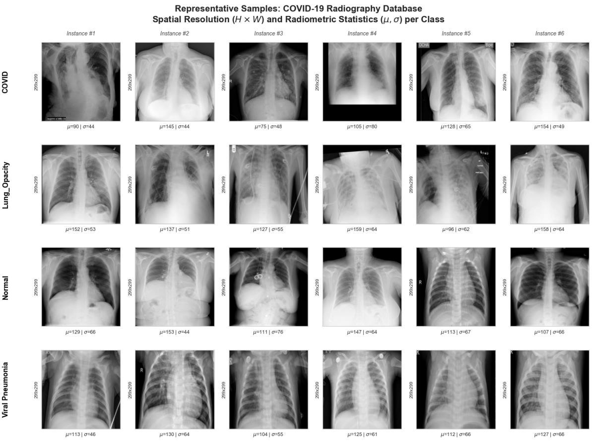
  <p><em>Figure 2 (Fig. 2 in JEEEMI): Representative samples from the COVID-19 Radiography Database (6 instances per category) illustrating native spatial resolution ($299 \times 299$) and radiometric pixel statistics ($\mu, \sigma$).</em></p>
</div>

<div align="center">
  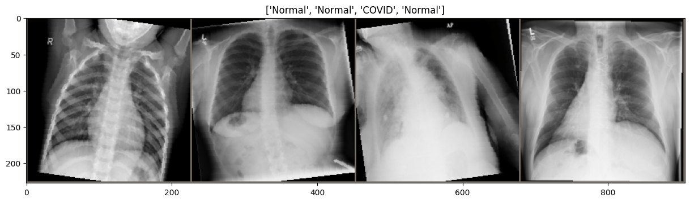
  <p><em>Figure 3: Sample training mini-batch of 4 radiographs after inverse Z-score denormalization.</em></p>
</div>

### 4.2 Preprocessing & Z-Score Standardization — Equation (1)

Every radiograph undergoes a standardized preprocessing pipeline prior to model ingestion:

1. **Channel Alignment (Grayscale to RGB):** Single-channel CXR images are converted to 3-channel RGB tensors (`Image.open(path).convert("RGB")`) to match the input dimensionality of the ImageNet-pretrained DenseNet-121 backbone.
2. **Spatial Resizing:** All images are resized from $299 \times 299$ to **$224 \times 224$ pixels** (`transforms.Resize((224, 224))`).
3. **Z-Score Standardization (Equation 1):** Let $x^{(c)} \in [0, 1]$ denote the resized pixel intensity for channel $c \in \{R, G, B\}$. The standardized input $x_{\text{norm}}^{(c)}$ is computed as:

$$
x_{\text{norm}}^{(c)} = \frac{x^{(c)} - \mu_c}{\sigma_c} \tag{1}
$$

where $\mu_c = [0.485, \ 0.456, \ 0.406]$ and $\sigma_c = [0.229, \ 0.224, \ 0.225]$ represent the ImageNet channel-wise mean and standard deviation.
4. **Conditional Data Augmentation:** Random horizontal flips (`RandomHorizontalFlip(p=0.5)`) and random rotations within $\pm 10^\circ$ (`RandomRotation(10)`) are applied **exclusively to the training set**. Validation and testing sets remain unaugmented to ensure deterministic evaluation.

---

## 5. System Architecture & Mathematical Methodology

<div align="center">
  
  <p><em>Figure 4 (Fig. 1 in JEEEMI): End-to-End System Architecture and Adversarial Attacks Pipeline comprising (1) Data Acquisition & Preprocessing, (2) DenseNet-121 Architecture, (3) White-Box Attack Engine (FGSM & PGD), (4) Quantitative Performance Evaluation, and (5) Grad-CAM Spatial Interpretability.</em></p>
</div>

### 5.1 DenseNet-121 Architecture & Feature Propagation — Equation (2)

We employ **DenseNet-121** as the core feature extractor. Unlike standard CNNs or ResNets that sum feature maps across skip connections, DenseNet concatenates all preceding feature maps within a Dense Block to maximize gradient flow and feature reuse. Let $x_\ell$ denote the output of the $\ell$-th layer:

$$
x_\ell = H_\ell\left([x_0, x_1, \dots, x_{\ell-1}]\right) \tag{2}
$$

where $[x_0, x_1, \dots, x_{\ell-1}]$ denotes channel-wise concatenation of feature maps from layers $0$ to $\ell - 1$, and $H_\ell(\cdot)$ is a composite function of Batch Normalization (BN), ReLU, a $1 \times 1$ bottleneck convolution, and a $3 \times 3$ convolution with growth rate $k = 32$.

<div align="center">
  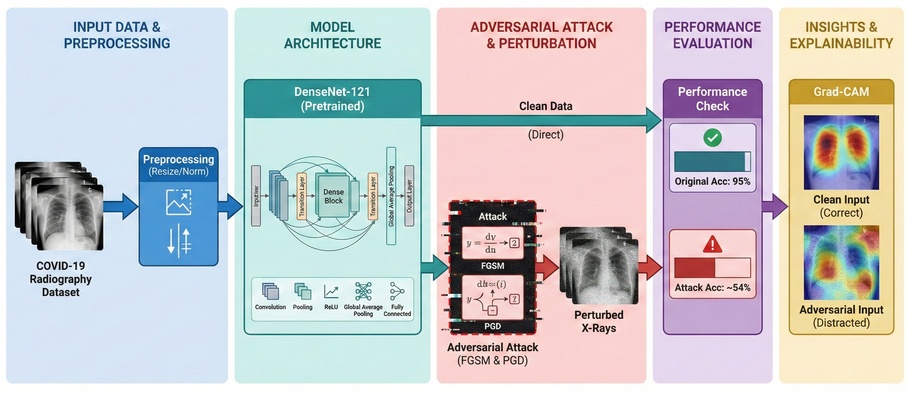
  <p><em>Figure 5: Detailed structural breakdown of DenseNet-121 with 4 Dense Blocks, 3 Transition Layers, Global Average Pooling, and the modified 4-class Linear Classification Head.</em></p>
</div>

| Architectural Block | Internal Configuration | Output Tensor Shape |
|:--------------------|:-----------------------|:-------------------:|
| **Input Layer** | Standardized RGB CXR Tensor | $224 \times 224 \times 3$ |
| **Initial Convolution** | $7 \times 7$ Conv (stride 2), BN, ReLU $\rightarrow$ $3 \times 3$ MaxPool (stride 2) | $56 \times 56 \times 64$ |
| **Dense Block 1** | $L = 6$ dense layers ($k = 32$) | $56 \times 56 \times 256$ |
| **Transition Layer 1** | BN, ReLU, $1 \times 1$ Conv ($\theta = 0.5$) $\rightarrow$ $2 \times 2$ AvgPool (stride 2) | $28 \times 28 \times 128$ |
| **Dense Block 2** | $L = 12$ dense layers ($k = 32$) | $28 \times 28 \times 512$ |
| **Transition Layer 2** | BN, ReLU, $1 \times 1$ Conv ($\theta = 0.5$) $\rightarrow$ $2 \times 2$ AvgPool (stride 2) | $14 \times 14 \times 256$ |
| **Dense Block 3** | $L = 24$ dense layers ($k = 32$) | $14 \times 14 \times 1024$ |
| **Transition Layer 3** | BN, ReLU, $1 \times 1$ Conv ($\theta = 0.5$) $\rightarrow$ $2 \times 2$ AvgPool (stride 2) | $7 \times 7 \times 512$ |
| **Dense Block 4** | $L = 16$ dense layers ($k = 32$) — Grad-CAM Target Layer (`model.features[-1]`) | $7 \times 7 \times 1024$ |
| **Global Average Pooling** | $7 \times 7$ spatial average pooling | $1 \times 1 \times 1024$ |
| **Classification Head** | `nn.Linear(in_features=1024, out_features=4)` + Softmax | $4$ (`COVID`, `Lung_Opacity`, `Normal`, `Viral Pneumonia`) |

### 5.2 Training Protocol & Loss Function — Equation (3)

The network parameters $\theta$ are optimized end-to-end using the **Adam** optimizer ($\text{lr} = 10^{-4}$, batch size $= 32$, maximum $50$ epochs, Early Stopping $\text{patience} = 5$) under the categorical **Cross-Entropy Loss**:

$$
J(\theta, x, y) = -\sum_{i=1}^{K} y_i \log(\hat{y}_i) \tag{3}
$$

where $K = 4$, $y_i \in \{0, 1\}$ is the ground-truth indicator, and $\hat{y}_i$ is the predicted softmax probability. Both FGSM and PGD compute exact gradients $\nabla_x J(\theta, x, y)$ from this identical loss function under a strict white-box threat model.

### 5.3 Fast Gradient Sign Method (FGSM) — Equation (4)

FGSM is a single-step attack grounded in the local linearity hypothesis of neural networks. It perturbs the input $x$ in a single step of magnitude $\epsilon$ along the sign of the loss gradient:

$$
x_{\text{adv}} = x + \epsilon \cdot \text{sign}\left(\nabla_x J(\theta, x, y)\right) \tag{4}
$$

In normalized input space, the perturbation step is scaled channel-wise by the ImageNet standard deviation tensor ($\epsilon_{\text{norm}} = \epsilon / \sigma_c$). Because FGSM takes a single step correlated with raw image gradients, its perturbation concentrates along high-frequency anatomical boundaries (ribs and clavicles), creating structured *"edge artifacts"*.

<div align="center">
  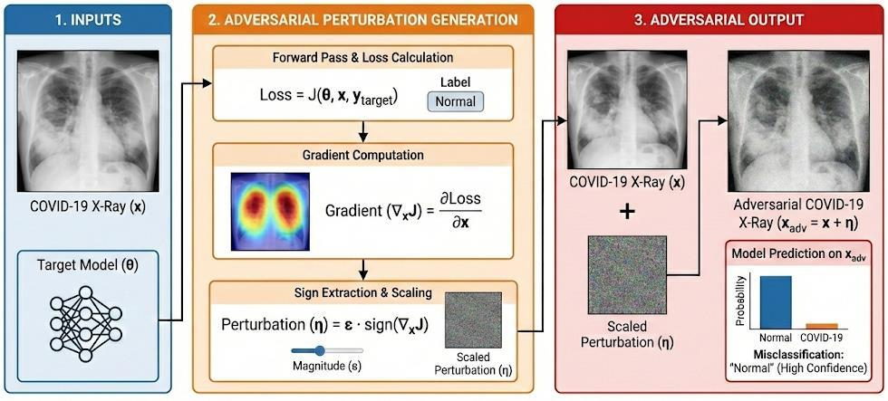
  <p><em>Figure 6 (Fig. 3 in JEEEMI): Illustration of the Single-Step Fast Gradient Sign Method (FGSM) Perturbation Generation Pipeline.</em></p>
</div>

### 5.4 Projected Gradient Descent (PGD) — Equation (5)

To overcome the underfitting of single-step linear approximations on curved decision boundaries, **Projected Gradient Descent (PGD)** formulates adversarial generation as a constrained iterative optimization problem within the $L_\infty$ $\epsilon$-ball $S = \{x' : \|x' - x\|_\infty \le \epsilon\}$:

$$
x^{t+1} = \Pi_{x + S}\left(x^t + \alpha \cdot \text{sign}\left(\nabla_x J(\theta, x^t, y)\right)\right) \tag{5}
$$

Starting from a uniform random initialization $x^0 \sim \mathcal{U}(x - \epsilon, x + \epsilon)$, PGD iteratively updates $x^t$ with step size $\alpha = \epsilon / 4$ over $N = 10$ iterations and projects the result back onto the feasible $\epsilon$-ball and valid pixel range $[0, 1]$. Setting $\alpha = \epsilon/4$ and $N = 10$ guarantees that the total optimization trajectory distance:

$$
N \cdot \alpha = 10 \cdot \left(\frac{\epsilon}{4}\right) = 2.5\epsilon > 2\epsilon
$$

strictly exceeds the diameter of the $L_\infty$-ball ($2\epsilon$), ensuring complete spatial coverage of the feasible perturbation volume and preventing false robustness (*gradient masking*).

<div align="center">
  
  <p><em>Figure 7 (Fig. 4 in JEEEMI): Illustration of Iterative Projected Gradient Descent (PGD) Optimization with $\epsilon$-Ball Projection.</em></p>
</div>

### 5.5 Quantitative Evaluation Metrics & Grad-CAM Formulations — Equations (6) to (12)

Classification performance across clean and perturbed test sets is quantified using **Accuracy (Eq. 6)**, **Precision (Eq. 7)**, **Recall (Eq. 8)**, and **F1-Score (Eq. 9)**:

$$
\text{Accuracy} = \frac{TP + TN}{TP + TN + FP + FN} \tag{6}
$$

$$
\text{Precision} = \frac{TP}{TP + FP} \tag{7} \qquad \text{Recall} = \frac{TP}{TP + FN} \tag{8} \qquad \text{F1-Score} = 2 \cdot \frac{\text{Precision} \cdot \text{Recall}}{\text{Precision} + \text{Recall}} \tag{9}
$$

To interpret internal network mechanics, **Grad-CAM** computes neuron importance weights $\alpha_k^c$ by globally averaging the gradients of target class score $y^c$ with respect to the $k$-th feature map $A_{ij}^k$ of the final convolutional layer (`model.features[-1]`, $Z = 7 \times 7 = 49$):

$$
\alpha_k^c = \frac{1}{Z} \sum_{i} \sum_{j} \frac{\partial y^c}{\partial A_{ij}^k} \tag{10} \qquad L_{\text{Grad-CAM}}^c = \text{ReLU}\left(\sum_{k} \alpha_k^c A^k\right) \tag{11}
$$

Spatial attention displacement between the flattened clean activation map ($M_{\text{clean}}$) and adversarial activation map ($M_{\text{adv}}$) is quantified using **Cosine Similarity ($S_c$)**:

$$
S_c = \frac{M_{\text{clean}} \cdot M_{\text{adv}}}{\|M_{\text{clean}}\| \, \|M_{\text{adv}}\|} \tag{12}
$$

---

## 6. Experimental Results & Quantitative Analysis

### 6.1 Model Performance on Clean Data (Baseline)

During fine-tuning, training and validation loss converged smoothly with minimal oscillation, triggering Early Stopping (`patience = 5`) at Epoch 9 after validation accuracy peaked at Epoch 4 (saved to `best_densenet121_covid_4class.pth`).

<div align="center">
  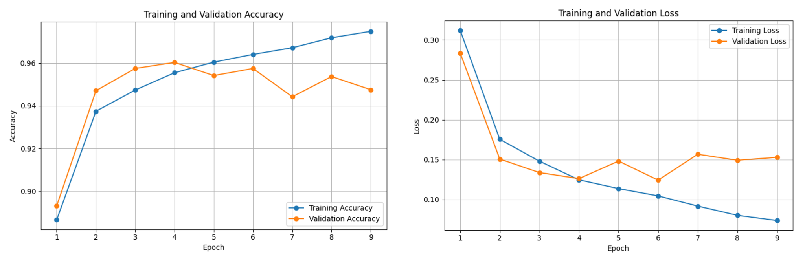
  <p><em>Figure 8 (Fig. 5 in JEEEMI): Training and Validation (a) Accuracy and (b) Loss convergence curves for DenseNet-121.</em></p>
</div>

On the unseen clean test set ($N = 2,117$), the model achieved a baseline accuracy of **95.42%** (95% CI: **94.53% – 96.31%**, $2,020 / 2,117$ correct predictions) and an average prediction confidence of **96.05%**.

<div align="center">
  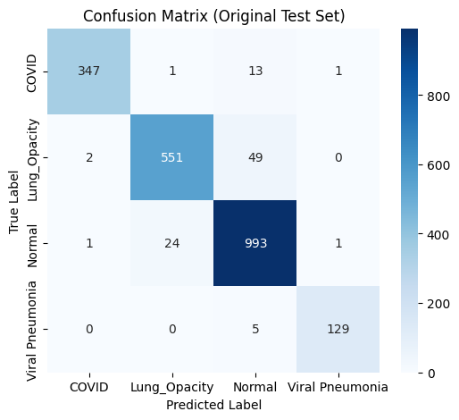
  <p><em>Figure 9 (Fig. 6 in JEEEMI): Confusion Matrix on the Original Clean Test Set ($N = 2,117$, Accuracy = 95.42%).</em></p>
</div>

| True Label \ Predicted Label | COVID-19 | Lung Opacity | Normal | Viral Pneumonia | Support ($N$) | Class Precision | Class Recall | Class F1-Score |
|:-----------------------------|:--------:|:------------:|:------:|:---------------:|:-------------:|:---------------:|:------------:|:--------------:|
| **COVID-19** | **347** | 1 | 13 | 1 | 362 | 0.9914 | 0.9586 | **0.9747** |
| **Lung Opacity** | 2 | **551** | 49 | 0 | 602 | 0.9566 | 0.9153 | **0.9355** |
| **Normal** | 1 | 24 | **993** | 1 | 1,019 | 0.9368 | 0.9745 | **0.9553** |
| **Viral Pneumonia** | 0 | 0 | 5 | **129** | 134 | 0.9847 | 0.9627 | **0.9736** |
| **Macro / Weighted Avg** | — | — | — | — | **2,117** | 0.9674 / 0.9548 | 0.9528 / 0.9542 | **0.9598 / 0.9541** |

---

### 6.2 Model Performance under Perturbed Data at Critical Threshold ($\epsilon = 0.1/255$)

Subjecting the test set ($N = 2,117$) to sub-pixel FGSM and PGD perturbations at $\epsilon = 0.1/255$ ($\approx 0.000392$ in $[0, 1]$) induced severe, statistically deterministic performance collapse:

#### Table 2 (JEEEMI): Class-Wise Performance Comparison (Original vs. FGSM vs. PGD at $\epsilon = 0.1/255$)

| Diagnostic Category | Metric | Original (Clean) | FGSM Attack ($\epsilon = 0.1/255$) | PGD Attack ($\epsilon = 0.1/255$) |
|:--------------------|:-------|:----------------:|:----------------------------------:|:---------------------------------:|
| **COVID-19**<br>($N = 362$) | Precision<br>Recall<br>**F1-Score** | $0.9914$<br>$0.9586$<br>**0.9747** | $0.4844$<br>$0.5138$<br>**0.4987** ($\downarrow \mathbf{48.83\%}$) | $0.1540$<br>$0.1796$<br>**0.1658** ($\downarrow \mathbf{82.99\%}$) |
| **Lung Opacity**<br>($N = 602$) | Precision<br>Recall<br>**F1-Score** | $0.9566$<br>$0.9153$<br>**0.9355** | $0.4576$<br>$0.4568$<br>**0.4572** ($\downarrow \mathbf{51.13\%}$) | $0.0960$<br>$0.1130$<br>**0.1038** ($\downarrow \mathbf{88.90\%}$) |
| **Normal**<br>($N = 1,019$) | Precision<br>Recall<br>**F1-Score** | $0.9368$<br>$0.9745$<br>**0.9553** | $0.6989$<br>$0.6742$<br>**0.6863** ($\downarrow \mathbf{28.16\%}$) | $0.4095$<br>$0.3288$<br>**0.3647** ($\downarrow \mathbf{61.82\%}$) |
| **Viral Pneumonia**<br>($N = 134$) | Precision<br>Recall<br>**F1-Score** | $0.9847$<br>$0.9627$<br>**0.9736** | $0.7181$<br>$0.7985$<br>**0.7562** ($\downarrow \mathbf{22.33\%}$) | $0.4024$<br>$0.5075$<br>**0.4488** ($\downarrow \mathbf{53.91\%}$) |
| **Overall ($N=2,117$)** | **Accuracy** | **95.42%** | **59.28%** | **25.32%** |

#### Tables 3 & 4 (JEEEMI): Global Accuracy, ASR, Confidence Misalignment & McNemar's Test ($\epsilon = 0.1/255$)

| Dataset Condition | Epsilon ($\epsilon$) | Global Accuracy (%) | Exact Binomial 95% CI | Attack Success Rate (ASR %) | Avg. Prediction Confidence (%) | McNemar's Test vs. Clean |
|:------------------|:--------------------:|:-------------------:|:---------------------:|:---------------------------:|:------------------------------:|:------------------------:|
| **Original (Clean)** | `0` | **95.42%** | $94.53\% - 96.31\%$ | — | **96.05%** | Baseline |
| **FGSM Attack** | `0.1/255` (`0.000392`) | **59.28%** | $57.19\% - 61.37\%$ | **40.72%** | **82.16%** | $\chi^2 = 763.00 \ (p \ll 0.001)$ |
| **PGD Attack** | `0.1/255` (`0.000392`) | **25.32%** | $23.42\% - 27.12\%$ | **74.68%** | **85.42%** | $\chi^2 = 1483.00 \ (p \ll 0.001)$ |

<div align="center">
  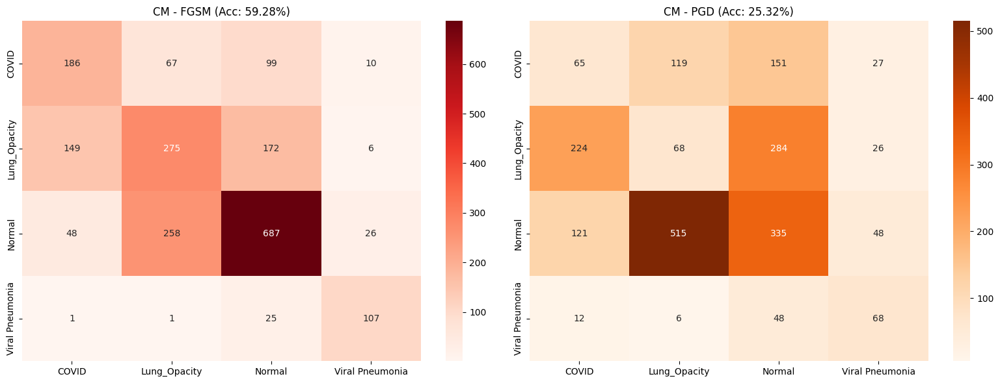
  <p><em>Figure 10: Side-by-side Confusion Matrices for FGSM (left, 59.28% accuracy) and PGD (right, 25.32% accuracy) at $\epsilon = 0.1/255$.</em></p>
</div>

<div align="center">
<table>
<tr>
<td align="center" width="50%">
  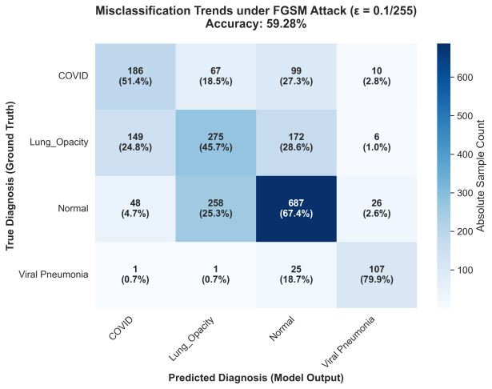
  <p><em>Figure 11 (Fig. 7 in JEEEMI): Misclassification trends under FGSM ($\epsilon = 0.1/255$, Accuracy = 59.28%) with sample counts and class-normalized percentages.</em></p>
</td>
<td align="center" width="50%">
  
  <p><em>Figure 12 (Fig. 8 in JEEEMI): Misclassification trends under PGD ($\epsilon = 0.1/255$, Accuracy = 25.32%), highlighting near-total collapse in Lung Opacity (11.3% correct) and COVID-19 (18.0% correct).</em></p>
</td>
</tr>
</table>
</div>

<div align="center">
  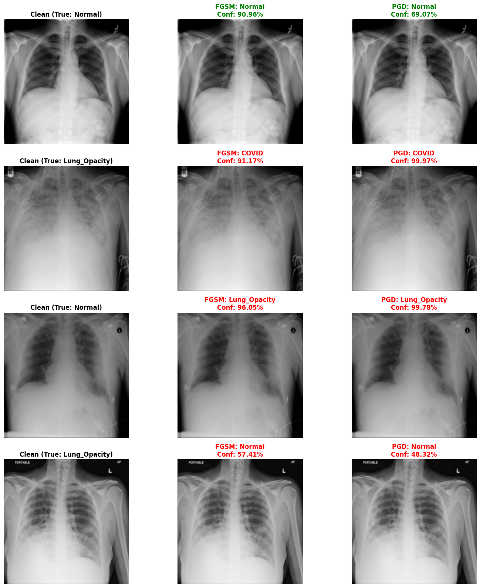
  <p><em>Figure 13: Visual comparison of Clean, FGSM ($\epsilon = 0.1/255$), and PGD ($\epsilon = 0.1/255$) radiographs. Although the images are visually identical to the human eye, the model misclassifies perturbed samples with high confidence.</em></p>
</div>

---

### 6.3 Sub-Pixel Sensitivity & Robustness Profiles (Tables 5 & 6 in JEEEMI)

To identify the exact breakdown threshold of the model, fine-grained sensitivity sweeps were conducted across sub-pixel epsilon intervals ($\epsilon < 1/255$).

<div align="center">
  
  <p><em>Figure 14 (Fig. 11 in JEEEMI): Robustness Profile comparing accuracy degradation across sub-pixel and micro noise levels for FGSM and PGD relative to the 95.42% clean baseline.</em></p>
</div>

#### Table 5 (JEEEMI): Sub-Pixel FGSM Sensitivity Experiment ($\epsilon = 0.1/255$ to $0.9/255$)

| Epsilon Label | Decimal Value ($\epsilon$) | FGSM Accuracy (%) | FGSM Attack Success Rate (ASR %) | Accuracy Drop from Baseline |
|:-------------:|:--------------------------:|:-----------------:|:--------------------------------:|:---------------------------:|
| **0 (Clean)** | `0.000000` | **95.4180%** | `0.0000%` | — |
| **0.1/255** | `0.000392` | **59.2820%** | **40.7180%** | $-36.14\%$ |
| **0.2/255** | `0.000784` | **32.8767%** | **67.1233%** | $-62.54\%$ |
| **0.3/255** | `0.001176` | **21.7289%** | **78.2711%** | $-73.69\%$ |
| **0.4/255** | `0.001569` | **15.1630%** | **84.8370%** | $-80.26\%$ |
| **0.5/255** | `0.001961` | **12.1398%** | **87.8602%** | $-83.28\%$ |
| **0.6/255** | `0.002353` | **10.3921%** | **89.6079%** | $-85.03\%$ |
| **0.7/255** | `0.002745` | **9.3056%** | **90.6944%** | $-86.11\%$ |
| **0.8/255** | `0.003137` | **9.2584%** | **90.7416%** | $-86.16\%$ |
| **0.9/255** | `0.003529` | **9.0222%** | **90.9778%** | $-86.40\%$ |

#### Table 6 (JEEEMI) & Extended Sweep: Sub-Pixel PGD Sensitivity Experiment ($\alpha = \epsilon/4, N = 10$)

| Epsilon Label | Decimal Value ($\epsilon$) | PGD Accuracy (%) | PGD Attack Success Rate (ASR %) | Robustness Regime |
|:-------------:|:--------------------------:|:----------------:|:-------------------------------:|:------------------|
| **0 (Clean)** | `0.000000` | **95.4180%** | `0.0000%` | Optimal Clean Baseline |
| **0.01/255** | `0.000039` | **92.8200%** | **7.1800%** | Initial Sub-Pixel Degradation ($\downarrow 2.60\%$) |
| **0.025/255** | `0.000098` | **86.3014%** | **13.6986%** | Early Boundary Instability ($\downarrow 9.12\%$) |
| **0.05/255** | `0.000196` | **66.6509%** | **33.3491%** | Steep Manifold Degradation ($\downarrow 28.77\%$) |
| **0.1/255** | `0.000392` | **25.5078% / 25.3188%** | **74.4922% / 74.6812%** | **Critical Degradation Threshold** ($\approx$ Random Guess) |
| **0.2/255** | `0.000784` | **1.5116%** | **98.4884%** | Near-Complete Collapse |
| **0.3/255** | `0.001176` | **0.0472% / 0.1417%** | **99.9528% / 99.8583%** | **Total Predictive Collapse** (1–3 of 2,117 correct) |
| **0.4/255 – 0.5/255** | `0.001569 – 0.001961` | **0.0472%** | **99.9528%** | Only 1 of 2,117 instances correct |
| **0.6/255 – 0.9/255** | `0.002353 – 0.003529` | **0.0000%** | **100.0000%** | **0 of 2,117 instances correct (100% ASR)** |

<div align="center">
<table>
<tr>
<td align="center" width="50%">
  
  <p><em>Figure 15: FGSM sub-pixel tolerance curve ($0.1/255 - 0.9/255$) illustrating the linear-step plateau around 9.02% accuracy.</em></p>
</td>
<td align="center" width="50%">
  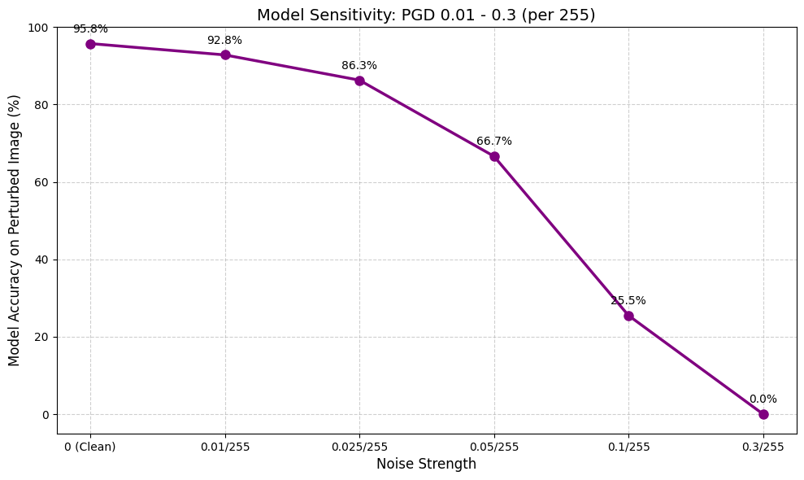
  <p><em>Figure 16: PGD low-range sensitivity curve ($0.01/255 - 0.3/255$) illustrating exponential collapse to 0.05%.</em></p>
</td>
</tr>
</table>
</div>

---

## 7. Grad-CAM Interpretability: Semantic Decoupling vs. Semantic Inversion

To uncover the internal mechanism driving metric collapse, **Grad-CAM** heatmaps were extracted from `model.features[-1]` and compared across Clean, FGSM, and PGD conditions using **Cosine Similarity ($S_c$, Equation 12)**.

<div align="center">
  
  <p><em>Figure 17: Representative $4 \times 6$ Grad-CAM comparison across all four diagnostic classes under Clean, FGSM ($\epsilon = 0.1/255$), and PGD ($\epsilon = 0.1/255$) conditions.</em></p>
</div>

### 7.1 Two Modes of Topological Attention Shift

| Spatial Failure Mode | Affected Classes | Cosine Similarity ($S_c$) | Mechanistic Interpretation |
|:---------------------|:-----------------|:-------------------------:|:---------------------------|
| **Semantic Decoupling** | **Lung Opacity** ($S_c = 0.32$)<br>**Normal** ($S_c = 0.38$) | $S_c \ll 0.50$ | Iterative PGD optimization destroys the spatial coherence of internal feature maps. Predictive attention detaches from pulmonary parenchyma and anchors onto non-diagnostic background edges (clavicles, rib cages, and image corners). |
| **Semantic Inversion** | **COVID-19** ($S_c \approx 0.79$)<br>*(Global PGD mean $S_c = 0.41$)* | $S_c \approx 0.79$ | Spatial attention remains anchored on the anatomical lung fields, but high-frequency adversarial perturbations synthesize deceptive local textures inside the ROI, forcing high-confidence misclassification into *Viral Pneumonia*. |
| **Partial Spatial Retention** | **Viral Pneumonia** ($S_c = 0.58$) | $S_c > 0.50$ | Dense macro-structural infiltrates in lower spatial frequencies retain partial activation overlap, explaining its lower F1-score drop ($\downarrow 53.91\%$ vs. $\downarrow 88.90\%$ for Lung Opacity). |

### 7.2 PGD Progression Visualizations (Fig. 9a – 9d in JEEEMI)

<div align="center">
<table>
<tr>
<td align="center" width="50%">
  
  <p><em>Figure 18a (Fig. 9a in JEEEMI): PGD progression on Normal class ($\epsilon = 0.01/255 \rightarrow 0.1/255$).</em></p>
</td>
<td align="center" width="50%">
  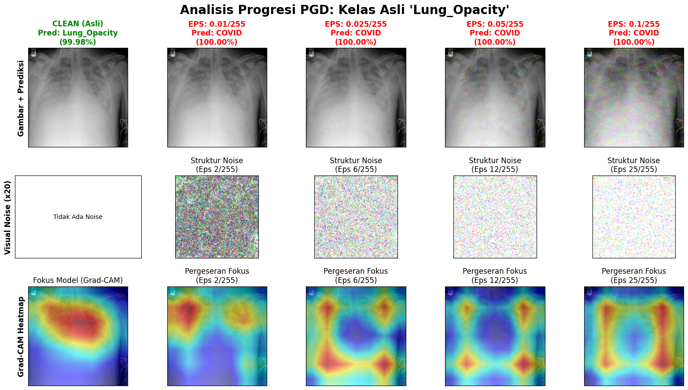
  <p><em>Figure 18b (Fig. 9b in JEEEMI): PGD progression on Lung Opacity class ($\epsilon = 0.01/255 \rightarrow 0.1/255$).</em></p>
</td>
</tr>
<tr>
<td align="center" width="50%">
  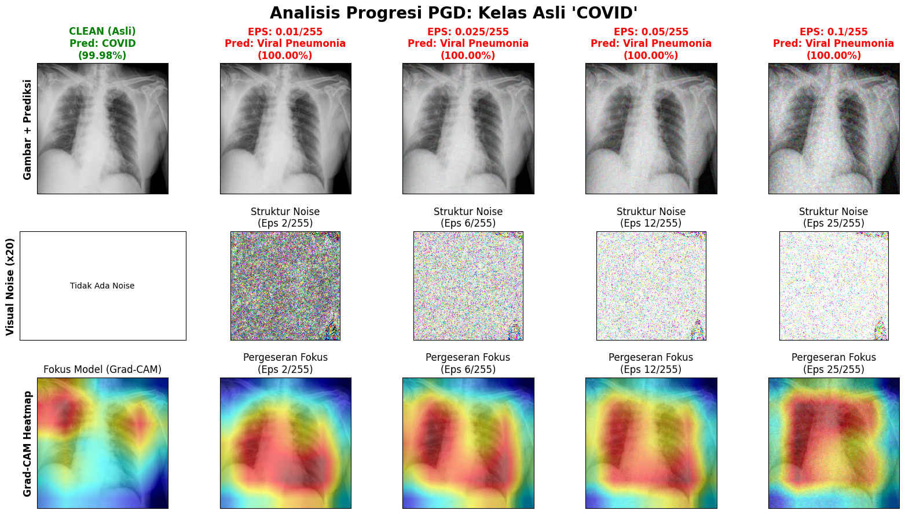
  <p><em>Figure 18c (Fig. 9c in JEEEMI): PGD progression on COVID-19 class ($\epsilon = 0.01/255 \rightarrow 0.1/255$).</em></p>
</td>
<td align="center" width="50%">
  
  <p><em>Figure 18d (Fig. 9d in JEEEMI): PGD progression on Viral Pneumonia class ($\epsilon = 0.01/255 \rightarrow 0.1/255$).</em></p>
</td>
</tr>
</table>
</div>

### 7.3 FGSM Auto-Enhanced Noise Progression Visualizations (Fig. 10a – 10d in JEEEMI)

<div align="center">
<table>
<tr>
<td align="center" width="50%">
  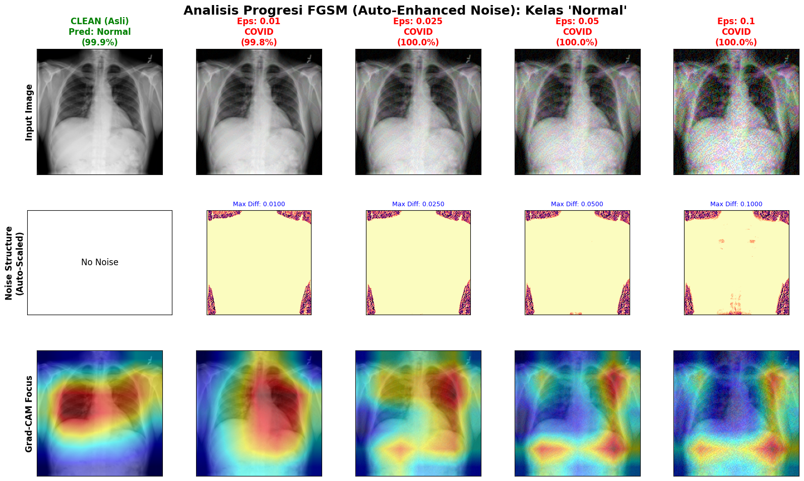
  <p><em>Figure 19a (Fig. 10a in JEEEMI): FGSM Auto-Enhanced Noise progression on Normal class.</em></p>
</td>
<td align="center" width="50%">
  
  <p><em>Figure 19b (Fig. 10b in JEEEMI): FGSM Auto-Enhanced Noise progression on Lung Opacity class.</em></p>
</td>
</tr>
<tr>
<td align="center" width="50%">
  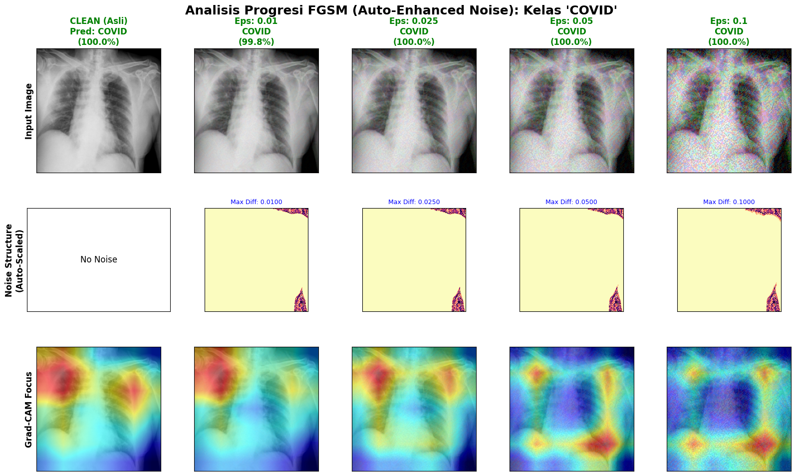
  <p><em>Figure 19c (Fig. 10c in JEEEMI): FGSM Auto-Enhanced Noise progression on COVID-19 class.</em></p>
</td>
<td align="center" width="50%">
  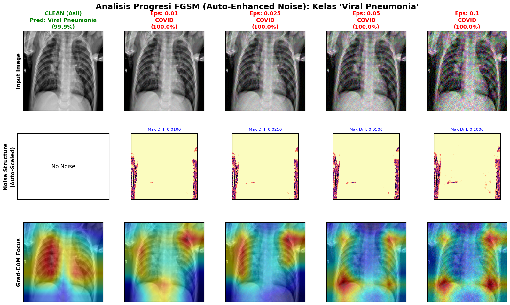
  <p><em>Figure 19d (Fig. 10d in JEEEMI): FGSM Auto-Enhanced Noise progression on Viral Pneumonia class.</em></p>
</td>
</tr>
</table>
</div>

---

## 8. Defense Recommendations & Future Directions

To transition medical imaging models from fragile Empirical Risk Minimization (ERM) toward clinical-grade resilience, this study establishes three defense paradigms:

1. **Min-Max Saddle Point Adversarial Training (AT):**  
   Reformulating the training objective by continuously generating iterative PGD adversaries in an inner maximization loop and updating network weights $\theta$ in an outer minimization loop:
   
   $$\min_{\theta} \; \mathbb{E}_{(x, y) \sim \mathcal{D}} \left[ \max_{\|\delta\|_\infty \le \epsilon} J(\theta, x + \delta, y) \right]$$
   
   coupled with **class-wise robustness weighting** to protect high-frequency biomarker classes (*Lung Opacity* and *COVID-19*).
2. **Attention-Guided Regularization via Grad-CAM Cosine Similarity:**  
   Penalizing spatial divergence between clean ($M_{\text{clean}}$) and adversarial ($M_{\text{adv}}$) Grad-CAM activation maps directly in the training loss:
   
   $$\mathcal{L}_{\text{total}} = J(\theta, x_{\text{adv}}, y) + \lambda \cdot \left(1 - \frac{M_{\text{clean}} \cdot M_{\text{adv}}}{\|M_{\text{clean}}\| \, \|M_{\text{adv}}\|}\right)$$
   
   constraining feature extraction to remain anchored on pulmonary anatomy.
3. **Multi-Layered Input Preprocessing & Runtime Detection:**  
   Integrating *Feature Squeezing* (bit-depth reduction and local spatial smoothing), *High-Level Representation Guided Denoisers (HGD)*, and runtime Grad-CAM clustering to reject inputs exhibiting off-organ *Semantic Decoupling*.

---

## 9. Technology Stack & Repository Structure

### 9.1 Core Technology Stack

| Category | Packages & Versions | Purpose |
|:---------|:--------------------|:--------|
| **Deep Learning & Vision** | `torch>=2.5.0`, `torchvision>=0.20.0`, `pillow>=11.0.0` | DenseNet-121 fine-tuning, tensor pipelines, white-box FGSM & PGD attacks |
| **Explainable AI (XAI)** | `grad-cam>=1.5.0` (`pytorch_grad_cam`) | Grad-CAM activation extraction on `model.features[-1]` and heatmap overlays |
| **Data Science & Metrics** | `numpy>=2.0.0`, `pandas>=2.2.0`, `scikit-learn>=1.5.0` | Stratified data splitting, classification reports, confusion matrices |
| **Scientific Visualization** | `matplotlib>=3.9.0`, `seaborn>=0.13.0`, `tqdm>=4.66.0` | Progression grids, auto-scaled magma noise heatmaps, robustness curves |
| **Documentation Platform** | `mkdocs>=1.6.1`, `mkdocs-material>=9.7.7`, `mkdocs-jupyter>=0.26.3`, `mkdocs-glightbox>=0.5.2`, `mkdocs-minify-plugin>=0.8.0`, `pymdown-extensions>=12.3` | Static documentation website with MathJax 3, Mermaid diagrams, lightbox zoom, and inline Jupyter rendering |

### 9.2 Complete Repository Structure

```text
covid19-xray-adversarial-attack/
├── .devcontainer/
│   └── devcontainer.json               # GitHub Codespaces & VS Code DevContainer configuration
├── .github/
│   └── workflows/
│       └── docs.yml                    # Automated CI/CD workflow for GitHub Pages deployment
├── datasets/                           # [1] Dataset Specification & Partitioning Guide
│   └── README.md
├── journal/                            # [2] Published JEEEMI Journal Paper & Citation Metadata
│   ├── README.md
│   └── journal-1506-Article Text-8082-1-10-20260428.pdf
├── models/                             # [3] Pretrained DenseNet-121 Checkpoint Specification
│   └── README.md
├── notebooks/                          # [4] Primary Experimental Jupyter Notebook (45 Cells)
│   ├── README.md
│   └── covid19_xray_adversarial_robustness.ipynb
├── results/                            # [5] Experimental Outputs, GPU Logs & All 54 Figures
│   ├── README.md
│   ├── full_hasil.txt                  # Complete console output log from CUDA GPU evaluation
│   └── figures/                        # Physical directory containing all 54 PNG figures
│       └── (*.png)
├── docs/                               # [6] Self-Contained Documentation Website Module (MkDocs)
│   ├── README.md
│   ├── mkdocs.yml                      # MkDocs configuration (docs_dir: site_docs)
│   ├── requirements.txt                # Documentation build dependencies
│   ├── sync_docs.sh                    # Synchronization script for notebooks, figures, and paper
│   └── site_docs/                      # Documentation Markdown source tree & static assets
│       ├── about/
│       ├── conclusions/
│       ├── dataset/
│       ├── experiments/
│       ├── images/                     # Physical PNG image assets for MkDocs site
│       ├── implementation/
│       ├── javascripts/
│       ├── methodology/
│       ├── overrides/
│       ├── publications/
│       ├── results/
│       ├── stylesheets/
│       ├── index.md
│       ├── references.md
│       └── tags.md
├── .gitattributes                      # Git LFS tracking for model checkpoints (*.pth)
├── .gitignore                          # Git ignore rules for build artifacts and caches
├── LICENSE                             # Dual License (MIT + CC BY-SA 4.0) & Clinical Disclaimer
├── requirements.txt                    # Core Deep Learning & research Python dependencies
└── README.md                           # Main repository documentation
```

### 9.3 Map of the 45 Cells in `notebooks/covid19_xray_adversarial_robustness.ipynb`

| Notebook Section | Cells | Summary of Implementation |
|:-----------------|:-----:|:--------------------------|
| **Step 1 & Part 1: Data Ingestion & Stratified Split** | `0 – 8` | Verifies the 21,165 images across 4 folders, executes the 80:10:10 stratified split (`16,932` train / `2,116` val / `2,117` test), defines `CovidDataset`, and visualizes normalized training batches. |
| **Part 2: DenseNet-121 Training & Checkpoint Loading** | `9 – 10` | Initializes `densenet121(weights='DEFAULT')` with a 4-class linear head, defines `train_model` (`EPOCHS=50`, `PATIENCE=5`, `lr=1e-4`), and loads `best_densenet121_covid_4class.pth`. |
| **Part 3: White-Box FGSM & PGD Attack Functions** | `11 – 12` | Implements `fgsm_attack` (Eq. 4) and `pgd_attack` (Eq. 5) with normalized-space perturbation scaling ($\epsilon / \text{STD\_TENSOR}$). |
| **Parts 4, 5 & 5.5: Clean, FGSM & PGD Evaluations** | `13 – 17` | Evaluates clean test accuracy (**95.42%**), FGSM accuracy (**59.28%**), PGD accuracy, classification reports, and confusion matrices. |
| **Parts 6, 7 & 8: Grad-CAM & Amplified Noise Grids** | `18 – 24` | Computes Grad-CAM on `model.features[-1]`, rendering $4 \times 6$ overview grids, 5-sample class blocks (6 columns), and 8-column blocks with $15\times$ amplified noise. |
| **Parts 9a / 13, 14 & Part 10 (FGSM): Sub-Pixel FGSM** | `25 – 29` | Executes the 9-step FGSM sub-pixel sweep ($0.1/255 - 0.9/255$), 10-column progression grids ($50\times$ noise), and Auto-Enhanced Magma Noise progressions (Fig. 10a–d). |
| **Parts 9b, 10, 11 & 12 (PGD): Sub-Pixel PGD** | `30 – 40` | Executes the custom low-range PGD sweep ($0.01/255 - 0.3/255$ with $\alpha = \epsilon/4, N = 10$), PGD progression grids (Fig. 9a–d), and full sub-pixel PGD sweep ($0.1/255 - 0.9/255$). |
| **Dedicated Micro-Attack Evaluation & Part 15 Final Report** | `41 – 44` | Runs unified Clean vs. FGSM vs. PGD evaluation at $\epsilon = 0.1/255$ (Tables 2, 3, and 4 in JEEEMI), generates `cm_fgsm_vs_pgd_0.1.png`, plots Fig. 11 (`robustness_profile_...png`), and compiles the final report. |

---

## 10. Installation, Reproduction & Documentation Guide

### 10.1 Local Research Environment Setup

```bash
# 1. Clone the repository
git clone https://github.com/hisyam99/covid19-xray-adversarial-attack.git
cd covid19-xray-adversarial-attack

# 2. Create and activate a virtual environment
python3 -m venv venv
source venv/bin/activate

# 3. Install core Deep Learning dependencies
pip install --upgrade pip
pip install -r requirements.txt
```

### 10.2 Reproducing the Experiments on Kaggle / Cloud GPU

1. Open [Kaggle Notebooks](https://www.kaggle.com/code) or Google Colab with a **CUDA GPU accelerator** (NVIDIA Tesla T4 or P100).
2. Mount the **[COVID-19 Radiography Database](https://www.kaggle.com/datasets/tawsifurrahman/covid19-radiography-database)** at `/kaggle/input/covid19-radiography-database/COVID-19_Radiography_Dataset`.
3. Upload `notebooks/covid19_xray_adversarial_robustness.ipynb` and run all cells sequentially.

### 10.3 Serving & Building the Documentation Website (`docs/`)

```bash
# Install documentation dependencies
pip install -r docs/requirements.txt

# Synchronize artifacts into docs/site_docs/
./docs/sync_docs.sh

# Start the live-reloading local documentation server
mkdocs serve -f docs/mkdocs.yml --dev-addr 127.0.0.1:8000
```

Access the local site at `http://127.0.0.1:8000/covid19-xray-adversarial-attack/`. To run a strict production build:

```bash
mkdocs build -f docs/mkdocs.yml --strict -d ../site
```

---

## 11. Citation, References & License

### 11.1 How to Cite This Work

If you find this research, codebase, or experimental analysis useful in your work, please cite our JEEEMI article:

```bibtex
@article{kamil2026robustness,
  author    = {Kamil, Muhammad Hisyam and Farma, Elga Putri Tri and Basuki, Setio},
  title     = {Robustness Under Attack: Assessing Adversarial Fragility in Deep Learning Models for COVID-19 Radiography Prediction},
  journal   = {Journal of Electronics, Electromedical Engineering, and Medical Informatics (JEEEMI)},
  volume    = {8},
  number    = {2},
  pages     = {769--788},
  month     = {April},
  year      = {2026},
  issn      = {2656-8632},
  doi       = {10.35882/jeeemi.v8i2.1506},
  url       = {https://doi.org/10.35882/jeeemi.v8i2.1506}
}
```

### 11.2 Key Primary References

1. **Chowdhury, M. E. H., et al.** (2020). "Can AI Help in Screening Viral and COVID-19 Pneumonia?," *IEEE Access*, vol. 8, pp. 132665–132676. DOI: `10.1109/ACCESS.2020.3010287`.
2. **Li, Y., & Liu, S.** (2023). "The Threat of Adversarial Attack on a COVID-19 CT Image-Based Deep Learning System," *Bioengineering*, vol. 10, no. 2, p. 194. DOI: `10.3390/bioengineering10020194`.
3. **Kansal, K., et al.** (2022). "Defending against adversarial attacks on Covid-19 classifier: A denoiser-based approach," *Heliyon*, vol. 8, no. 10, p. e11209. DOI: `10.1016/j.heliyon.2022.e11209`.
4. **Zhang, J., et al.** (2024). "Revisiting the Trustworthiness of Saliency Methods in Radiology AI," *Radiology: Artificial Intelligence*, vol. 6, no. 1, p. e220221. DOI: `10.1148/ryai.220221`.
5. **Sim, J. H., & Song, H. M.** (2025). "A Generalized Framework for Adversarial Attack Detection and Prevention Using Grad-CAM and Clustering Techniques," *Systems*, vol. 13, no. 2, p. 88. DOI: `10.3390/systems13020088`.

*(The complete list of 53 references is available in [`docs/site_docs/references.md`](docs/site_docs/references.md)).*

### 11.3 License

This repository is protected under a dual-licensing framework (see [`LICENSE`](LICENSE) for full legal terms):

- **Source Code & Software ([MIT License](LICENSE)):** Copyright (c) 2026 Muhammad Hisyam Kamil, Elga Putri Tri Farma, and Setio Basuki. Requires preservation of copyright and attribution notices and provides strict *"AS IS"* no-warranty / no-liability protection for the authors.
- **Journal Article, Figures & Documentation ([CC BY-SA 4.0](https://creativecommons.org/licenses/by-sa/4.0/)):** Requires explicit attribution to the authors and official DOI (`10.35882/jeeemi.v8i2.1506`) and mandates that any derivative works of the paper, figures, or documentation be shared under the same license.
- **Medical & Clinical Disclaimer:** Provided strictly for academic AI security research; not intended or certified for autonomous clinical diagnosis.
