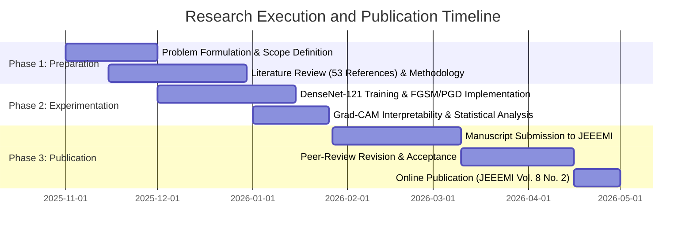

# Research Questions, Objectives & Scope

This research investigates white-box gradient-based adversarial vulnerability across three complementary analytical dimensions:

1. **Single-Step Linear Perturbation Analysis (FGSM)**
2. **Iterative First-Order Optimization Analysis (PGD)**
3. **Comparative Head-to-Head & Spatial Interpretability Synthesis (Grad-CAM & Cosine Similarity)**

---

## Research Questions

=== "Unified Research Questions (JEEEMI Study)"

    1. What is the baseline classification performance of the **DenseNet-121** architecture across the four diagnostic categories (*COVID-19*, *Lung Opacity*, *Normal*, and *Viral Pneumonia*) on the clean *COVID-19 Radiography Dataset*?
    2. How do varying $L_\infty$-bounded sub-pixel perturbation magnitudes ($\epsilon$) under single-step **FGSM** and iterative **PGD** attacks impact global and class-wise *Accuracy*, *Precision*, *Recall*, *F1-Score*, *Attack Success Rate* (ASR), and *Prediction Confidence*?
    3. What underlying radiological and spatial-frequency factors cause asymmetric vulnerability across the four diagnostic classes when subjected to gradient-based perturbations?
    4. How does the model's spatial inference focus shift post-attack when analyzed via **Grad-CAM** and quantified via **Cosine Similarity ($S_c$)**, and how do *Semantic Decoupling* and *Semantic Inversion* manifest across classes?

=== "FGSM Analytical Focus"

    1. How does single-step **Fast Gradient Sign Method (FGSM)** across sub-pixel bounds ($\epsilon \in \{0.1/255 \dots 0.9/255\}$) degrade global and class-wise classification metrics?
    2. Why does single-step FGSM exhibit a steep initial drop followed by a performance degradation plateau at higher sub-pixel epsilon values?
    3. How do high-frequency *"edge artifacts"* generated by FGSM along anatomical boundaries (ribs and clavicles) trigger spatial attention shifts in Grad-CAM?

=== "PGD Analytical Focus"

    1. How does iterative **Projected Gradient Descent (PGD)** optimization ($\alpha = \epsilon/4, N = 10$) across $\epsilon \in \{0.01/255 \dots 0.3/255\}$ navigate non-linear decision manifolds to induce exponential performance collapse?
    2. At what critical sub-pixel threshold does the DenseNet-121 model lose its diagnostic reliability, and at what bound does total collapse ($\text{accuracy} \approx 0\%$) occur?
    3. How does PGD's scattered *"salt-and-pepper"* perturbation profile disrupt global feature coherence and induce severe *Semantic Decoupling* ($S_c \ll 0.50$)?

---

## Research Objectives

1. **Baseline Model Validation:** Train and evaluate a pretrained **DenseNet-121** architecture on the *COVID-19 Radiography Dataset* to establish a high-precision clean baseline (**95.42%** test accuracy).
2. **Multi-Spectrum Sub-Pixel Robustness Quantification:** Implement white-box **FGSM** ($\epsilon = 0.1/255$ to $0.9/255$) and **PGD** ($\epsilon = 0.01/255$ to $0.9/255$, $\alpha = \epsilon/4$, $N = 10$) attacks to map accuracy degradation and ASR curves.
3. **Statistical Significance & Class-Wise Vulnerability Analysis:** Quantify class-wise *Precision*, *Recall*, and *F1-Score* degradation, validating statistical significance using exact binomial **95% Confidence Intervals (Clopper-Pearson)** and **McNemar's Test ($\chi^2$)**.
4. **Spatial Interpretability via Grad-CAM & Cosine Similarity:** Visualize Grad-CAM heatmaps alongside amplified and auto-scaled noise structures, and compute **Cosine Similarity ($S_c$)** to prove *Semantic Decoupling* and *Semantic Inversion*.
5. **Formulation of Defense Frameworks:** Establish mathematical recommendations for *Adversarial Training* (min-max saddle point optimization) and *Attention-Guided Regularization*.

---

## Operational Scope & Limitations

- **Standardized Public Benchmark:** Evaluation is conducted exclusively on the *COVID-19 Radiography Dataset* (**21,165 CXR images** across four classes: *Normal*, *Lung Opacity*, *COVID-19*, and *Viral Pneumonia*) to maintain strict experimental reproducibility.
- **Target Architecture:** Focused on **DenseNet-121** pretrained on ImageNet (~7.8–8 million parameters) as a representative dense-connectivity medical imaging backbone.
- **White-Box $L_\infty$ Threat Model:** Evaluates untargeted white-box gradient attacks (**FGSM** and **PGD**) where the adversary has direct access to the exact loss gradients $\nabla_x J(\theta, x, y)$.
- **Sub-Pixel Perturbation Regime:** Focuses on sub-pixel bounds ($\epsilon < 1/255$, specifically $0.01/255$ to $0.9/255$) where perturbations remain completely invisible to human observers yet severely degrade unprotected models.
- **Unprotected Baseline Evaluation:** Measures the intrinsic vulnerability of standard Empirical Risk Minimization (ERM) training prior to applying active adversarial defenses.

---

## Research Execution Timeline

---

[:octicons-arrow-right-24: Continue to Research Team & Publication Details](team.md){ .md-button .md-button--primary }
