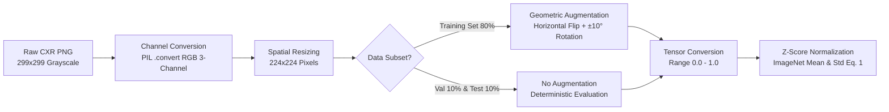

# Data Preprocessing & Augmentation Pipeline

Preprocessing ensures that all medical image data maintains identical quality, spatial resolution, and channel distribution prior to entering the **DenseNet-121** architecture without stripping critical diagnostic information.



---

## 1. Grayscale-to-RGB Channel Conversion

While chest X-ray images lack inherent color information, converting single-channel grayscale radiographs into three-channel RGB images via `Image.open(img_path).convert("RGB")` is mandatory to align input channel dimensions ($C = 3$) with the **DenseNet-121** backbone initialized with ImageNet pretrained weights.

---

## 2. Spatial Resizing ($224 \times 224$)

All images are resized from $299 \times 299$ pixels to **$224 \times 224$ pixels** using `transforms.Resize((224, 224))`. This resolution matches the receptive field geometry of DenseNet-121 while maintaining computational efficiency during batch training and iterative gradient computation.

---

## 3. Mathematical Formulation of Z-Score Standardization — Equation (1)

Following conversion to floating-point tensors in $[0, 1]$ via `transforms.ToTensor()`, pixel intensities are standardized per color channel $c \in \{R, G, B\}$ using **Equation (1)** from our JEEEMI paper:

$$
x_{\text{norm}}^{(c)} = \frac{x^{(c)} - \mu_c}{\sigma_c}, \quad c \in \{R, G, B\} \tag{1}
$$

where $\mu_c$ and $\sigma_c$ denote the ImageNet mean and standard deviation for each respective channel:

- **ImageNet Mean ($\mu_c$):** $\mu = [0.485, \ 0.456, \ 0.406]$
- **ImageNet Standard Deviation ($\sigma_c$):** $\sigma = [0.229, \ 0.224, \ 0.225]$

!!! warning "Implications for Adversarial Perturbation Scaling"
    Because the network operates on Z-score standardized inputs $x_{\text{norm}}^{(c)}$, any perturbation budget $\epsilon$ or step size $\alpha$ defined in raw pixel space $[0, 1]$ (such as $\epsilon = 0.1/255$) must be transformed into normalized space by dividing by the channel standard deviation tensor:
    
    $$\epsilon_{\text{norm}} = \frac{\epsilon}{\sigma_c}, \qquad \alpha_{\text{norm}} = \frac{\alpha}{\sigma_c}$$

---

## 4. Conditional Training Augmentation

To increase training diversity and mitigate overfitting, geometric data augmentation is applied **exclusively to the training partition (`train`)**:

1. **Random Horizontal Flip (`transforms.RandomHorizontalFlip(p=0.5)`):** Horizontally reflects images with 50% probability.
2. **Random Rotation (`transforms.RandomRotation(10)`):** Rotates images randomly within $[-10^\circ, +10^\circ]$ to account for minor patient positioning variations during radiography.

Augmentation is strictly excluded from the **Validation (`val`)** and **Testing (`test`)** partitions to guarantee impartial and reproducible evaluation.

---

## Implementation Code

```python
norm_mean = [0.485, 0.456, 0.406]
norm_std  = [0.229, 0.224, 0.225]

data_transforms = {
    'train': transforms.Compose([
        transforms.Resize((IMAGE_SIZE, IMAGE_SIZE)),
        transforms.RandomHorizontalFlip(),
        transforms.RandomRotation(10),
        transforms.ToTensor(),
        transforms.Normalize(norm_mean, norm_std)
    ]),
    'val': transforms.Compose([
        transforms.Resize((IMAGE_SIZE, IMAGE_SIZE)),
        transforms.ToTensor(),
        transforms.Normalize(norm_mean, norm_std)
    ]),
    'test': transforms.Compose([
        transforms.Resize((IMAGE_SIZE, IMAGE_SIZE)),
        transforms.ToTensor(),
        transforms.Normalize(norm_mean, norm_std)
    ]),
}
```

---

[:octicons-arrow-right-24: Continue to Dataset Citation & Ethical Compliance](citation.md){ .md-button .md-button--primary }
