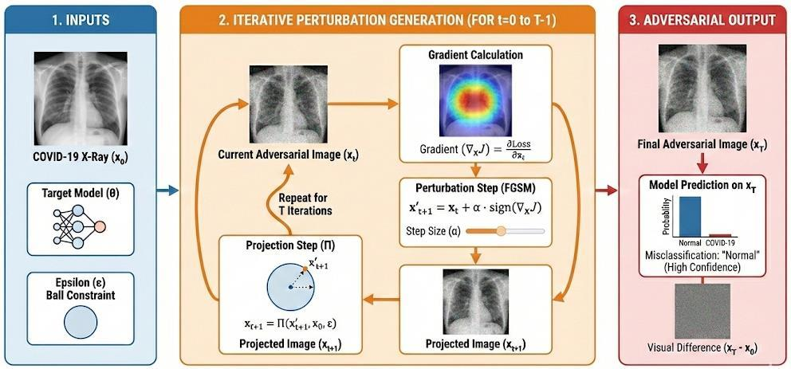

# Adversarial Attack Techniques (FGSM & PGD)

This section outlines the mathematical formulations and implementation protocols for the white-box gradient-based attacks (**FGSM** and **PGD**) presented in Section II.C of the JEEEMI article.

---

## 1. Fast Gradient Sign Method (FGSM) — Equation (4)

The **Fast Gradient Sign Method (FGSM)** is a "one-shot" single-step attack algorithm grounded in the linearity hypothesis of high-dimensional neural networks. FGSM approximates the optimal $L_\infty$-bounded adversarial perturbation by assuming the model's decision boundary remains linear in the local vicinity of the input $x$.

We compute the adversarial example $x_{\text{adv}}$ by taking a single step of size $\epsilon$ along the sign of the loss function's gradient $\nabla_x J(\theta, x, y)$ with respect to the input image $x$, as defined in **Equation (4)** of the JEEEMI article:

$$
x_{\text{adv}} = x + \epsilon \cdot \text{sign}\left(\nabla_x J(\theta, x, y)\right) \tag{4}
$$

where:

- $x$ denotes the clean input image,
- $y$ denotes the ground-truth class label,
- $\theta$ represents the trained model parameters,
- $J(\theta, x, y)$ is the classification loss function (cross-entropy), and
- $\epsilon$ is the hyperparameter constraining the maximum $L_\infty$ perturbation magnitude ($\|x_{\text{adv}} - x\|_\infty \le \epsilon$).

<div align="center">
  
  <p><em>Figure 1 (Fig. 3 in JEEEMI): Illustration of the Single-Step Fast Gradient Sign Method (FGSM) Pipeline.</em></p>
</div>

!!! info "Spatial Characteristics of FGSM Noise (Edge Artifacts)"
    Due to its single-step nature, FGSM generates perturbations that correlate strongly with the raw gradient of the image structure. Rather than distributing randomly, the noise concentrates on high-frequency spatial features such as anatomical boundaries (rib cages and clavicles). These *"edge artifacts"* distort the structural integrity of the Region of Interest (ROI).

---

## 2. Projected Gradient Descent (PGD) — Equation (5)

To overcome the limitations of single-step linear approximations, we employed **Projected Gradient Descent (PGD)** (Madry et al.), widely recognized as the universal first-order adversary. PGD formulates the attack as an iterative optimization problem constrained within an $L_\infty$ $\epsilon$-ball $S$.

Unlike FGSM, PGD iteratively ascends the loss landscape, recalculating the local gradient at each step to navigate non-linear decision boundaries effectively. **Equation (5)** of the JEEEMI article defines the update rule for the $t$-th iteration:

$$
x^{t+1} = \Pi_{x + S}\left(x^t + \alpha \cdot \text{sign}\left(\nabla_x J(\theta, x^t, y)\right)\right) \tag{5}
$$

where:

- $x^t$ is the adversarial image at iteration $t$ (initialized randomly at $x^0 \sim \mathcal{U}(x - \epsilon, x + \epsilon)$ within the feasible set $S$),
- $\alpha$ is the per-step size,
- $\Pi_{x + S}(\cdot)$ denotes the projection operator that clips the perturbed image back into the feasible $\epsilon$-neighborhood $S = \{x' : \|x' - x\|_\infty \le \epsilon\}$ and valid pixel range $[0, 1]$.

<div align="center">
  
  <p><em>Figure 2 (Fig. 4 in JEEEMI): Illustration of Iterative Projected Gradient Descent (PGD) Optimization with $\epsilon$-Ball Projection.</em></p>
</div>

### Mathematical Guarantee of Spatial Coverage ($\alpha = \epsilon/4, N = 10$)

The selection of PGD hyperparameters is governed by the optimization dynamics required to fully exploit the $L_\infty$-constrained space:

- **Step Size:** $\alpha = \epsilon / 4$
- **Maximum Iterations:** $N = 10$

This configuration provides a strict mathematical guarantee of spatial coverage: the total traversable distance during optimization is:

$$
N \cdot \alpha = 10 \cdot \left(\frac{\epsilon}{4}\right) = 2.5\epsilon > 2\epsilon
$$

Because $2.5\epsilon$ strictly exceeds the theoretical diameter of the $L_\infty$-ball ($2\epsilon$), the gradient ascent trajectory from any random initialization $x^0 \in S$ is guaranteed to span the entire feasible perturbation volume and converge to a strong local maximum within the loss landscape, avoiding suboptimal optimization or false robustness (*gradient masking*).

---

## 3. Evaluated Epsilon ($\epsilon$) Spectrum

| Experimental Scenario | Attack Method | Epsilon Bound ($\epsilon$ in $/255$) | Decimal Value ($[0, 1]$) | Step & Iteration Config |
|:----------------------|:-------------:|:-------------------------------------|:-------------------------|:------------------------|
| **Primary Critical Evaluation** | FGSM & PGD | $\epsilon = 0.1/255$ | `0.000392` | PGD: $\alpha = \epsilon/4, \ N = 10$ |
| **PGD Custom Low-Range Sensitivity** | PGD | $\{0.01, \ 0.025, \ 0.05, \ 0.1, \ 0.3\} / 255$ | `0.000039` – `0.001176` | $\alpha = \epsilon/4, \ N = 10$ |
| **FGSM Sub-Pixel Sensitivity (0.1 – 0.9)** | FGSM | $\{0.1, \ 0.2, \ 0.3, \ 0.4, \ 0.5, \ 0.6, \ 0.7, \ 0.8, \ 0.9\} / 255$ | `0.000392` – `0.003529` | Single-step ($N = 1$) |
| **PGD Sub-Pixel Sensitivity (0.1 – 0.9)** | PGD | $\{0.1, \ 0.2, \ 0.3, \ 0.4, \ 0.5, \ 0.6, \ 0.7, \ 0.8, \ 0.9\} / 255$ | `0.000392` – `0.003529` | $\alpha = \epsilon/4, \ N = 10$ |

---

## PyTorch Implementation in Normalized Space (Cell 12 & Cell 41)

```python
MEAN_TENSOR = torch.tensor([0.485, 0.456, 0.406], device=DEVICE).view(1, 3, 1, 1)
STD_TENSOR  = torch.tensor([0.229, 0.224, 0.225], device=DEVICE).view(1, 3, 1, 1)

def fgsm_attack(model, images, labels, epsilon):
    images = images.clone().detach().to(DEVICE)
    labels = labels.to(DEVICE)
    images.requires_grad = True
    
    outputs = model(images)
    loss = F.cross_entropy(outputs, labels)
    model.zero_grad()
    loss.backward()
    
    sign_data_grad = images.grad.data.sign()
    normalized_epsilon = epsilon / STD_TENSOR
    perturbed_image = images + normalized_epsilon * sign_data_grad
    return perturbed_image

def pgd_attack(model, images, labels, eps, alpha, steps):
    images = images.clone().detach().to(DEVICE)
    labels = labels.to(DEVICE)
    original_images = images.clone().detach()
    
    eps_norm   = eps / STD_TENSOR
    alpha_norm = alpha / STD_TENSOR
    
    dataset_min = (0 - MEAN_TENSOR) / STD_TENSOR
    dataset_max = (1 - MEAN_TENSOR) / STD_TENSOR
    
    # Random initialization within the epsilon-ball
    perturbation = torch.empty_like(images).uniform_(-1, 1) * eps_norm
    adv_images = torch.clamp(images + perturbation, min=dataset_min, max=dataset_max).detach()
    
    for _ in range(steps):
        adv_images.requires_grad = True
        outputs = model(adv_images)
        loss = F.cross_entropy(outputs, labels)
        
        grad = torch.autograd.grad(loss, adv_images, retain_graph=False, create_graph=False)[0]
        adv_images = adv_images.detach() + alpha_norm * grad.sign()
        
        # Projection back onto the L-infinity epsilon-ball and valid pixel range
        delta = torch.clamp(adv_images - original_images, min=-eps_norm, max=eps_norm)
        adv_images = torch.clamp(original_images + delta, min=dataset_min, max=dataset_max).detach()
        
    return adv_images
```

---

[:octicons-arrow-right-24: Continue to Evaluation Metrics, Statistical Tests & Grad-CAM](metrics.md){ .md-button .md-button--primary }
