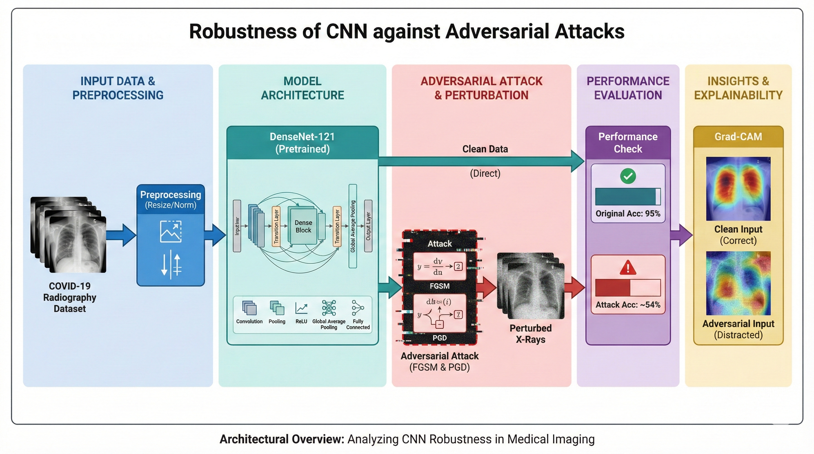
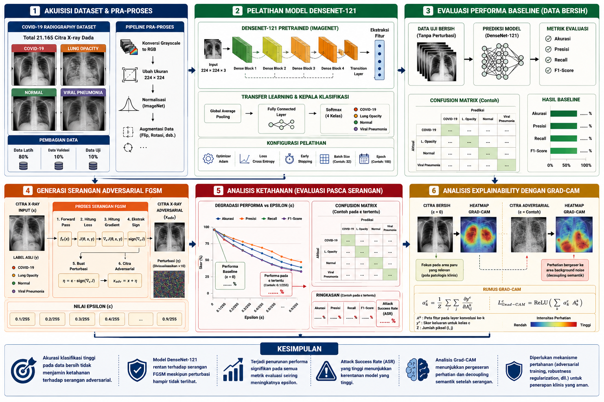
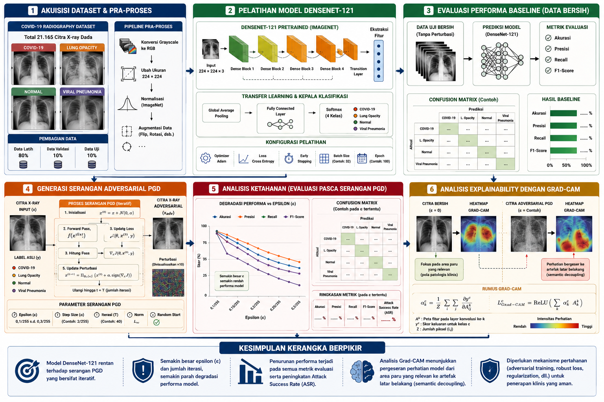

# Methodology Overview & Operational Pipeline

## Four Core Operational Stages (JEEEMI Framework)

To ensure a reproducible and systematically structured investigation, the proposed methodology follows **four primary operational stages** (illustrated as Stages 1–5 in **Figure 1 / Fig. 1 of the JEEEMI article**):

1. **Stage 1 — Data Acquisition & Strict Preprocessing:** Acquisition of 21,165 four-class CXR images from the *COVID-19 Radiography Dataset*, grayscale-to-RGB channel alignment, $224 \times 224$ spatial resizing, Z-score standardization using ImageNet statistics, stratified 80:10:10 partitioning, and training-only geometric augmentation.
2. **Stage 2 — CNN Model Architecture & Training Protocol:** Configuration of the pretrained **DenseNet-121** backbone comprising 4 Dense Blocks (6, 12, 24, and 16 layers), 3 Transition Layers, Global Average Pooling, and a 4-class linear classifier optimized via Categorical Cross-Entropy Loss and Adam ($\text{lr}=10^{-4}$).
3. **Stage 3 — White-Box Adversarial Attack Engine:** Generation of $L_\infty$-constrained gradient-based perturbations ($\|\delta\|_\infty \le \epsilon$) using single-step **FGSM** and iterative **PGD** ($\alpha = \epsilon/4, N = 10$) across sub-pixel and micro-perturbation bounds.
4. **Stages 4 & 5 — Quantitative Performance Evaluation & XAI Insight (Grad-CAM):** Execution of classification metrics (*Accuracy*, *Precision*, *Recall*, *F1-Score*, *ASR*, *Confidence*, 95% CI, McNemar's $\chi^2$ test) alongside **Grad-CAM** localization and **Cosine Similarity ($S_c$)** quantification to measure *Semantic Decoupling* and *Semantic Inversion*.

  
  
<em>Figure 1 (Fig. 1 in JEEEMI): End-to-End Architecture and Adversarial Attacks Evaluation Pipeline.</em>

---

## Detailed Research Workflow Diagrams

=== "FGSM Evaluation Workflow"

    

      
      
<em>Figure 2: Experimental workflow for evaluating DenseNet-121 vulnerability against single-step FGSM perturbations.</em>

    

=== "PGD Evaluation Workflow"

    

      
      
<em>Figure 3: Experimental workflow for evaluating DenseNet-121 vulnerability against iterative PGD perturbations.</em>

    

### Nine Sequential Execution Steps

| Step | Stage Name | Operational Description |
|:----:|:-----------|:------------------------|
| **1** | **Literature Review** | Synthesis of 53 scholarly references covering medical CNNs, DenseNet-121, FGSM/PGD attacks, and Grad-CAM interpretability. |
| **2** | **Dataset Acquisition** | Retrieval of the *COVID-19 Radiography Dataset* (21,165 CXR images across *Normal*, *Lung Opacity*, *COVID-19*, and *Viral Pneumonia*). |
| **3** | **Data Preprocessing** | RGB conversion, $224 \times 224$ resizing, ImageNet Z-score standardization, training augmentation, and stratified 80:10:10 splitting (`seed=42`). |
| **4** | **Model Construction & Training** | Initialization of pretrained DenseNet-121, replacement of the 4-class linear head, and fine-tuning for up to 50 epochs (`patience=5`). |
| **5** | **Baseline Performance Evaluation** | Evaluation on the clean test set ($N=2,117$) to establish the baseline accuracy (**95.42%**) and clean confusion matrix. |
| **6** | **Adversarial Attack Execution** | Generation of white-box adversarial test sets using **FGSM** and **PGD** across multiple sub-pixel $\epsilon$ budgets. |
| **7** | **Post-Attack Quantitative Evaluation** | Computation of degraded *Accuracy*, *Precision*, *Recall*, *F1-Score*, *ASR*, 95% CI, and McNemar's statistical significance. |
| **8** | **Grad-CAM & Spatial Similarity Analysis** | Extraction of activation maps from `model.features[-1]`, noise amplification visualization, and *Cosine Similarity* ($S_c$) calculation. |
| **9** | **Mechanistic Synthesis** | Interpretation of *Semantic Decoupling* vs. *Semantic Inversion* and formulation of robust defense recommendations. |

---

[:octicons-arrow-right-24: Continue to Preprocessing Formulation](preprocessing.md){ .md-button .md-button--primary }
