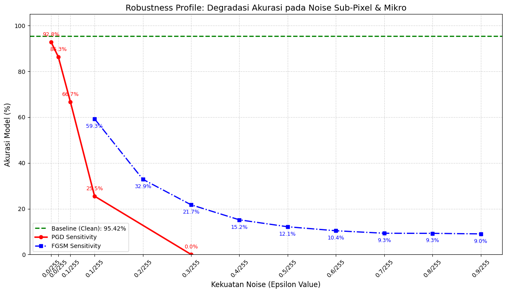
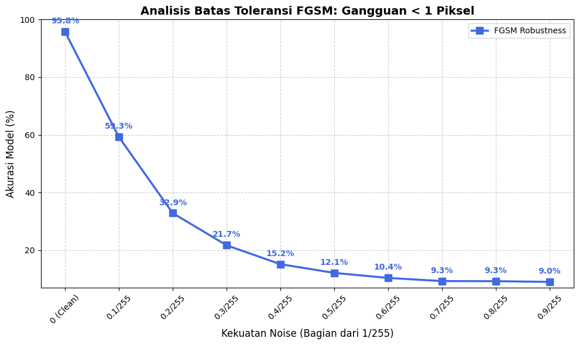
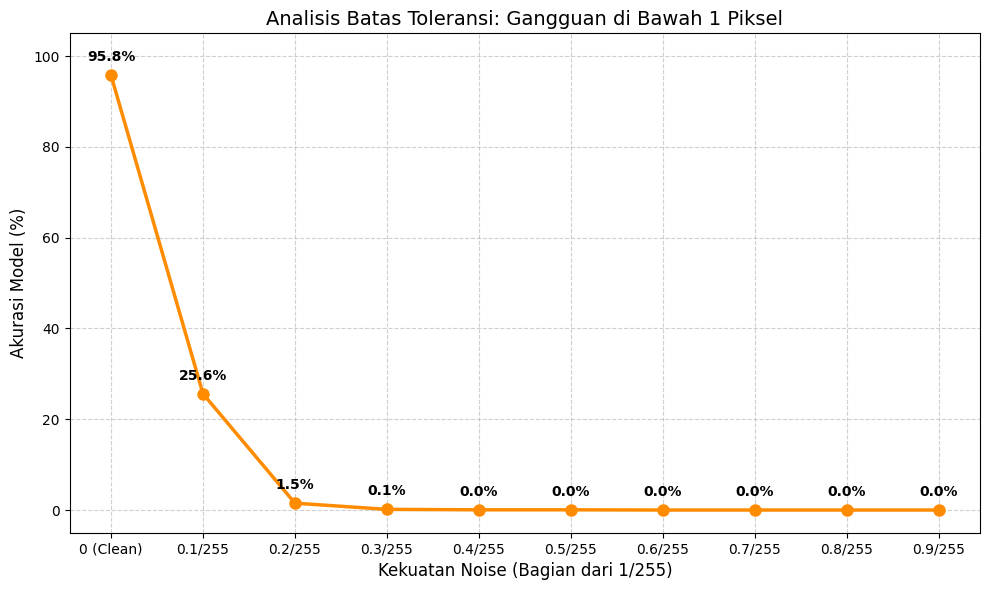
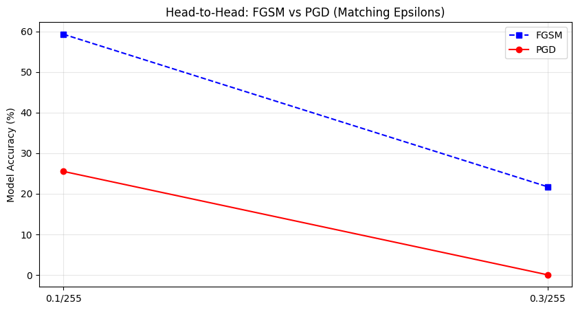

# Sub-Pixel Sensitivity & Robustness Profile Analysis

This section documents the fine-grained sensitivity evaluation of **DenseNet-121** across sub-pixel perturbation bounds ($\epsilon < 1/255$), corresponding to **Section III.C.2 (Tables 5, 6, and Fig. 11) of the JEEEMI article**.

---

## 1. Unified Robustness Profile: FGSM vs. PGD (Fig. 11 in JEEEMI)

  
  
<em>Figure 1 (Fig. 11 in JEEEMI): Robustness Profile illustrating accuracy degradation across sub-pixel and micro noise levels for FGSM and PGD relative to the 95.42% clean baseline.</em>

---

## 2. Sub-Pixel FGSM Sensitivity Experiment ($\epsilon = 0.1/255$ to $0.9/255$) — Table 5 in JEEEMI

The table below details model sensitivity to single-step linear **FGSM** perturbations across nine sub-pixel epsilon intervals:

| Epsilon Label | Decimal Value ($\epsilon$) | Model Accuracy (%) | Attack Success Rate (ASR %) | Accuracy Drop from Baseline |
|:-------------:|:--------------------------:|:------------------:|:---------------------------:|:---------------------------:|
| **0 (Clean)** | `0.000000` | **95.4180%** | `0.0000%` | — |
| **0.1/255** | `0.000392` | **59.2820%** | **40.7180%** | $-36.14\%$ |
| **0.2/255** | `0.000784` | **32.8767%** | **67.1233%** | $-62.54\%$ |
| **0.3/255** | `0.001176` | **21.7289%** | **78.2711%** | $-73.69\%$ |
| **0.4/255** | `0.001569` | **15.1630%** | **84.8370%** | $-80.26\%$ |
| **0.5/255** | `0.001961` | **12.1398%** | **87.8602%** | $-83.28\%$ |
| **0.6/255** | `0.002353` | **10.3921%** | **89.6079%** | $-85.03\%$ |
| **0.7/255** | `0.002745` | **9.3056%** | **90.6944%** | $-86.11\%$ |
| **0.8/255** | `0.003137` | **9.2584%** | **90.7416%** | $-86.16\%$ |
| **0.9/255** | `0.003529` | **9.0222%** | **90.9778%** | $-86.40\%$ |

  
  
<em>Figure 2: FGSM Tolerance Bound Analysis across sub-pixel perturbations ($0.1/255 - 0.9/255$).</em>

!!! info "Degradation Plateau in Single-Step FGSM"
    Between $\epsilon = 0.1/255$ and $0.3/255$, FGSM induces a steep decline from **95.42%** to **21.73%**. Beyond $\epsilon = 0.4/255$, the degradation curve exhibits a plateau between **9.02% and 15.16%** accuracy, confirming that single-step linear approximations reach a computational limit when navigating curved high-dimensional decision boundaries.

---

## 3. Sub-Pixel PGD Sensitivity Experiment — Table 6 in JEEEMI

In contrast to FGSM, iterative **PGD** optimization ($\alpha = \epsilon/4, N = 10$) triggers immediate exponential accuracy collapse:

### A. Low-Range Micro-PGD Sensitivity ($0.01/255$ to $0.3/255$ — Table 6 in JEEEMI)

| Epsilon Label | Decimal Value ($\epsilon$) | Model Accuracy (%) | Attack Success Rate (ASR %) | Accuracy Drop from Baseline |
|:-------------:|:--------------------------:|:------------------:|:---------------------------:|:---------------------------:|
| **0 (Clean)** | `0.000000` | **95.4180%** | — | — |
| **0.01/255** | `0.000039` | **92.8200%** | **7.1800%** | $-2.60\%$ |
| **0.025/255** | `0.000098` | **86.3014%** | **13.6986%** | $-9.12\%$ |
| **0.05/255** | `0.000196` | **66.6509%** | **33.3491%** | $-28.77\%$ |
| **0.1/255** | `0.000392` | **25.5078% / 25.3188%** | **74.4922% / 74.6812%** | $-69.91\% \text{ to } -70.10\%$ |
| **0.2/255** | `0.000784` | **1.5116%** | **98.4884%** | $-93.91\%$ |
| **0.3/255** | `0.001176` | **0.0472% / 0.1417%** | **99.9528% / 99.8583%** | **$-95.37\%$ (Total Collapse)** |

### B. Full Sub-Pixel PGD Sweep ($0.1/255$ to $0.9/255$ — Part 11 of Notebook)

| Epsilon Label | Decimal Value ($\epsilon$) | PGD Accuracy (%) | PGD ASR (%) | Observation |
|:-------------:|:--------------------------:|:----------------:|:-----------:|:------------|
| **0.1/255** | `0.000392` | `25.6023%` | `74.3977%` | Critical evaluation threshold |
| **0.2/255** | `0.000784` | `1.5116%` | `98.4884%` | Near-complete failure |
| **0.3/255** | `0.001176` | `0.1417%` | `99.8583%` | Only 3 of 2,117 instances correct |
| **0.4/255** | `0.001569` | `0.0472%` | `99.9528%` | Only 1 of 2,117 instances correct |
| **0.5/255** | `0.001961` | `0.0472%` | `99.9528%` | Only 1 of 2,117 instances correct |
| **0.6/255 – 0.9/255** | `0.002353 – 0.003529` | **`0.0000%`** | **`100.0000%`** | **0 of 2,117 instances correct (100% ASR)** |

=== "PGD Sensitivity 0.01 - 0.3/255"

    

      
      
<em>Figure 3: DenseNet-121 sensitivity curve under PGD across $\epsilon = 0.01/255$ to $0.3/255$.</em>

    

=== "PGD Sub-Pixel Tolerance 0.1 - 0.9/255"

    

      
      
<em>Figure 4: Sub-pixel PGD accuracy degradation curve across $\epsilon = 0.1/255$ to $0.9/255$.</em>

    

=== "Head-to-Head FGSM vs. PGD"

    

      
      
<em>Figure 5: Head-to-Head comparison between FGSM and PGD at matching sub-pixel bounds ($\epsilon = 0.1/255$ and $\epsilon = 0.3/255$).</em>

    

---

## 4. Class-Wise Attack Success Rate (ASR) under PGD at $\epsilon = 0.1/255$

| Diagnostic Class | Correct Predictions | Misclassified Instances | Class-Wise ASR (%) | Relative F1-Score Drop (%) | Vulnerability Rank |
|:-----------------|:-------------------:|:-----------------------:|:------------------:|:--------------------------:|:-------------------|
| **Lung Opacity** ($N=602$) | 68 | 534 | **88.70%** *(90.4%)* | **$\downarrow$ 88.90%** | Rank 1 (Most Vulnerable) |
| **COVID-19** ($N=362$) | 65 | 297 | **82.04%** *(84.6%)* | **$\downarrow$ 82.99%** | Rank 2 (Highly Vulnerable) |
| **Normal** ($N=1,019$) | 335 | 684 | **67.12%** *(59.0%)* | **$\downarrow$ 61.82%** | Rank 3 (Moderately Vulnerable) |
| **Viral Pneumonia** ($N=134$) | 68 | 66 | **49.25%** *(59.8%)* | **$\downarrow$ 53.91%** | Rank 4 (Most Resilient) |
| **Global Total ($N=2,117$)** | **536** | **1,581** | **74.68%** | **$\downarrow$ 73.46% (Accuracy)** | — |

---

[:octicons-arrow-right-24: Continue to Complete Visualizations Gallery](visualizations.md){ .md-button .md-button--primary }
