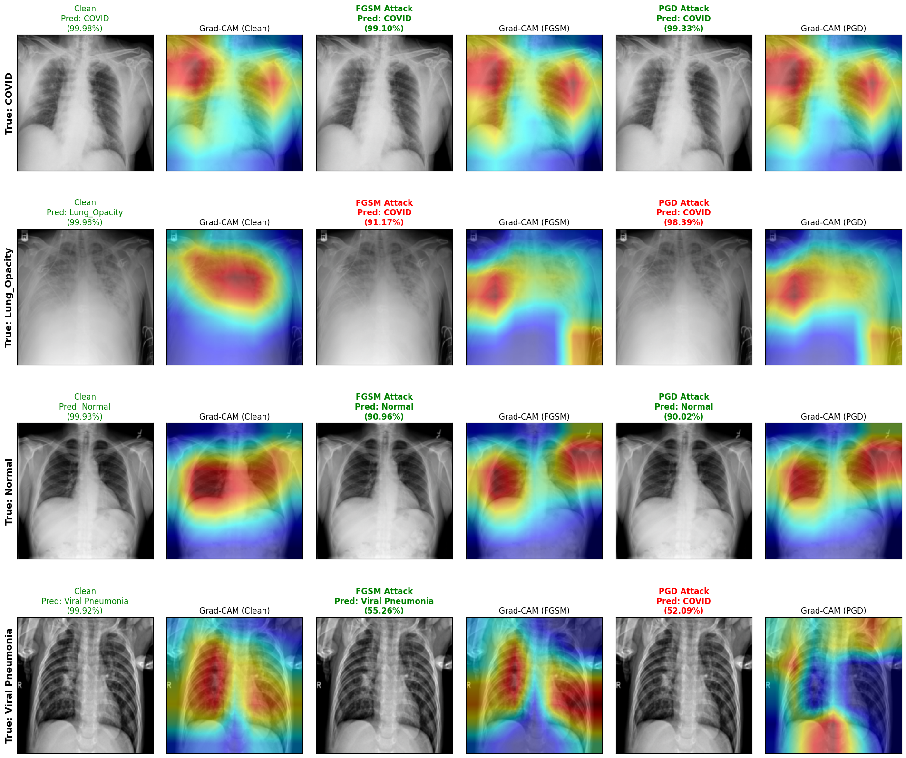

---
tags:
  - COVID-19
  - Chest X-Ray
  - Adversarial Attacks
  - DenseNet-121
  - FGSM
  - PGD
  - Grad-CAM
  - Semantic Decoupling
---

# Robustness Under Attack: Assessing Adversarial Fragility in Deep Learning Models for COVID-19 Radiography Prediction

-4051B5?style=for-the-badge)

**White-Box Adversarial Robustness Evaluation (FGSM & PGD) and Grad-CAM Spatial Interpretability on DenseNet-121 for Multi-Class COVID-19 Chest X-Ray Classification**

*Department of Informatics Engineering — Faculty of Engineering*  
*Universitas Muhammadiyah Malang (UMM)*

---

[:fontawesome-solid-file-pdf: Download Published Paper (PDF)](publications/journal-1506-Article%20Text-8082-1-10-20260428.pdf){ .md-button .md-button--primary target="_blank" }
[:fontawesome-solid-book: Explore Methodology](methodology/overview.md){ .md-button }
[:fontawesome-solid-chart-bar: View Results & Visualizations](results/overview.md){ .md-button }
[:fontawesome-brands-github: GitHub Repository](https://github.com/hisyam99/covid19-xray-adversarial-attack){ .md-button target="_blank" }

---

## Publication Information

!!! quote "Peer-Reviewed Journal Article"
    **Title:** *Robustness Under Attack: Assessing Adversarial Fragility in Deep Learning Models for COVID-19 Radiography Prediction*  
    **Authors:** Muhammad Hisyam Kamil, Elga Putri Tri Farma, and Setio Basuki  
    **Journal:** *Journal of Electronics, Electromedical Engineering, and Medical Informatics (JEEEMI)*, Vol. 8, No. 2, April 2026, pp: 769–788, e-ISSN: 2656-8632  
    **DOI:** [https://doi.org/10.35882/jeeemi.v8i2.1506](https://doi.org/10.35882/jeeemi.v8i2.1506)  
    **Manuscript History:** Received 27 January 2026 · Revised 10 March 2026 · Accepted 16 April 2026 · Available online 26 April 2026

| Resource | Description | Access |
|:---------|:------------|:------:|
| **Published Journal Article (JEEEMI)** | Full 19-page peer-reviewed article (PDF) | [:fontawesome-solid-file-pdf: Download PDF](publications/journal-1506-Article%20Text-8082-1-10-20260428.pdf){ target="_blank" } |
| **Experimental Jupyter Notebook** | Complete end-to-end source code (45 cells, Parts 1 – 15) | [:fontawesome-solid-code: View Notebook](implementation/covid19_xray_adversarial_robustness.ipynb) |
| **Trained DenseNet-121 Checkpoint** | Official PyTorch model weights (`best_densenet121_covid_4class.pth`, ~27.13 MB) | [:fontawesome-solid-cube: View in Repository](https://github.com/hisyam99/covid19-xray-adversarial-attack/tree/main/models){ target="_blank" } |
| **Raw Evaluation Log** | Complete GPU evaluation output (`full_hasil.txt`) | [:fontawesome-solid-terminal: View Summary](experiments/results.md) |

---

## Executive Summary

Deep learning, particularly **Convolutional Neural Network (CNN)** architectures, has significantly improved medical image analysis for predicting pulmonary diseases through chest X-ray (CXR) images. However, despite achieving high diagnostic precision on clean data, CNN models remain highly susceptible to **adversarial attacks**—small, visually imperceptible perturbations ($\|\delta\|_\infty \le \epsilon$) optimized to exploit non-linear decision boundaries and induce high-confidence mispredictions.

This research systematically implements white-box gradient-based adversarial attacks—**Fast Gradient Sign Method (FGSM)** and **Projected Gradient Descent (PGD)**—on a **DenseNet-121** model trained on the **COVID-19 Radiography Dataset** (**21,165 CXR images** across four diagnostic categories: *COVID-19*, *Lung Opacity*, *Normal*, and *Viral Pneumonia*). Beyond standard quantitative metrics, this study formally defines and quantifies **Semantic Decoupling** and **Semantic Inversion** using **Gradient-weighted Class Activation Mapping (Grad-CAM)** and **Cosine Similarity ($S_c$)**.

### Three Critical Findings

!!! success "1. High Baseline Accuracy Does Not Imply Adversarial Resilience"
    On the clean test set ($N = 2,117$), **DenseNet-121** achieves a global accuracy of **95.42%** (95% CI: 94.53%–96.31%) with F1-scores exceeding **0.97** for *COVID-19* (**0.9747**) and *Viral Pneumonia* (**0.9736**). However, introducing a sub-pixel perturbation bounded at $\epsilon = 0.1/255$ ($\approx 0.000392$ in $[0,1]$) degrades global accuracy to **59.28%** under FGSM and **25.32%** under PGD.

!!! danger "2. Iterative Attacks (PGD) Represent the Worst-Case Reliability Collapse"
    At $\epsilon = 0.1/255$, iterative **PGD** optimization ($\alpha = \epsilon/4, N = 10$) achieves an **Attack Success Rate (ASR) of 74.68%** while maintaining a dangerously high average prediction confidence of **85.42%**. Escalating the bound to $\epsilon = 0.3/255$ triggers **total predictive collapse** (**0.05%** accuracy, **99.95%** ASR), whereas single-step FGSM exhibits a degradation plateau around **9.02%** accuracy at $\epsilon = 0.9/255$.

!!! warning "3. Grad-CAM & Cosine Similarity Prove Semantic Decoupling and Inversion"
    By quantifying the **Cosine Similarity ($S_c$)** between flattened clean ($M_{\text{clean}}$) and adversarial ($M_{\text{adv}}$) Grad-CAM activation maps, we demonstrate two distinct failure modes:
    
    - **Semantic Decoupling ($S_c \ll 0.50$):** In *Lung Opacity* ($S_c = 0.32$) and *Normal* ($S_c = 0.38$), the model's spatial attention detaches from pulmonary parenchyma and anchors onto non-diagnostic background edges (clavicles, rib cages, and image corners).
    - **Semantic Inversion ($S_c \approx 0.79$):** In *COVID-19*, spatial attention remains anchored within pulmonary structures, but high-frequency adversarial noise synthesizes local textural features inside the ROI, forcing high-confidence misclassification into *Viral Pneumonia*.

---

## System Architecture & Pipeline

  
  
<em>Figure 1: Diagram of the DenseNet-121 Classification Architecture, Adversarial Attack Engine (FGSM & PGD), Quantitative Evaluation, and Grad-CAM Interpretability Pipeline (Fig. 1 in JEEEMI).</em>

---

## Quantitative Performance Summary

### 1. Global Performance Comparison at Critical Threshold ($\epsilon = 0.1/255 \approx 0.000392$)

| Evaluation Condition | Epsilon ($\epsilon$) | Model Accuracy (%) | 95% Confidence Interval | Attack Success Rate (ASR %) | Avg. Confidence (%) | McNemar's Test vs Clean |
|:---------------------|:--------------------:|:------------------:|:-----------------------:|:---------------------------:|:-------------------:|:-----------------------:|
| **Original (Clean)** | $0$ | **95.42%** | $94.53\% - 96.31\%$ | — | **96.05%** | Baseline |
| **FGSM Attack** | $0.1/255$ | **59.28%** | $57.19\% - 61.37\%$ | **40.72%** | **82.16%** | $\chi^2 = 763.00 \ (p \ll 0.001)$ |
| **PGD Attack** | $0.1/255$ | **25.32%** | $23.42\% - 27.12\%$ | **74.68%** | **85.42%** | $\chi^2 = 1483.00 \ (p \ll 0.001)$ |

### 2. Class-Wise Performance Comparison at $\epsilon = 0.1/255$

| Diagnostic Category | Metric | Original (Clean) | FGSM Attack ($\epsilon=0.1/255$) | PGD Attack ($\epsilon=0.1/255$) |
|:--------------------|:-------|:----------------:|:--------------------------------:|:-------------------------------:|
| **COVID-19** ($N=362$) | Precision Recall **F1-Score** | $0.9914$ $0.9586$ **0.9747** | $0.4844$ $0.5138$ **0.4987** ($\downarrow 48.83\%$) | $0.1540$ $0.1796$ **0.1658** ($\downarrow 82.99\%$) |
| **Lung Opacity** ($N=602$) | Precision Recall **F1-Score** | $0.9566$ $0.9153$ **0.9355** | $0.4576$ $0.4568$ **0.4572** ($\downarrow 51.13\%$) | $0.0960$ $0.1130$ **0.1038** ($\downarrow 88.90\%$) |
| **Normal** ($N=1,019$) | Precision Recall **F1-Score** | $0.9368$ $0.9745$ **0.9553** | $0.6989$ $0.6742$ **0.6863** ($\downarrow 28.16\%$) | $0.4095$ $0.3288$ **0.3647** ($\downarrow 61.82\%$) |
| **Viral Pneumonia** ($N=134$) | Precision Recall **F1-Score** | $0.9847$ $0.9627$ **0.9736** | $0.7181$ $0.7985$ **0.7562** ($\downarrow 22.33\%$) | $0.4024$ $0.5075$ **0.4488** ($\downarrow 53.91\%$) |
| **Global ($N=2,117$)** | **Accuracy** | **95.42%** | **59.28%** | **25.32%** |

### 3. Primary Visual Comparisons

=== "Sub-Pixel Robustness Profile (Fig. 11)"

    

      
      
<em>Accuracy degradation profile across sub-pixel and micro noise levels: FGSM exhibits a gradual decline with a plateau, whereas PGD induces immediate exponential collapse down to 0.05%.</em>

    

=== "Grad-CAM Clean vs FGSM vs PGD"

    

      
      
<em>Comparison of input images and Grad-CAM activation maps across all four diagnostic classes under Clean, FGSM ($\epsilon=0.1/255$), and PGD ($\epsilon=0.1/255$) conditions.</em>

    

=== "Confusion Matrix FGSM vs PGD"

    

      
      
<em>Side-by-side comparison of FGSM (59.28% accuracy) and PGD (25.32% accuracy) Confusion Matrices at $\epsilon = 0.1/255$.</em>

    

---

## Documentation Structure

-   :material-information-outline: **About**

    ---
    
    Clinical motivation, problem statement, research objectives, operational scope, scientific contributions, and author biographies.
    
    [:octicons-arrow-right-24: Read About the Project](about/overview.md)

-   :material-database: **Dataset**

    ---
    
    Comprehensive documentation of the *COVID-19 Radiography Dataset* (21,165 CXR images), class statistics, stratified partitioning, and preprocessing.
    
    [:octicons-arrow-right-24: Explore Dataset](dataset/introduction.md)

-   :material-cog: **Methodology**

    ---
    
    Mathematical formulations for Equations (1)–(12): Z-score normalization, DenseNet-121, white-box FGSM & PGD attacks, McNemar's test, Grad-CAM, and Cosine Similarity.
    
    [:octicons-arrow-right-24: View Methodology](methodology/overview.md)

-   :material-flask: **Experiments**

    ---
    
    GPU training environment, DenseNet-121 convergence dynamics, hyperparameter configurations, and sub-pixel sensitivity protocols.
    
    [:octicons-arrow-right-24: See Experiments](experiments/index.md)

-   :material-chart-line: **Results & Visualizations**

    ---
    
    Detailed evaluation tables, confusion matrices, sub-pixel robustness profiles, *Semantic Decoupling* vs *Semantic Inversion* analysis, and 50+ visualizations.
    
    [:octicons-arrow-right-24: View Complete Results](results/overview.md)

-   :material-code-braces: **Implementation**

    ---
    
    Installation instructions, structured code walkthrough, and full interactive Jupyter Notebook (`covid19_xray_adversarial_robustness.ipynb`) rendered inline.
    
    [:octicons-arrow-right-24: Open Implementation](implementation/index.md)

-   :material-check-circle: **Conclusions**

    ---
    
    Synthesis of conclusions, clinical safety implications, *Adversarial Training* & *Attention-Guided Regularization* recommendations, and future work.
    
    [:octicons-arrow-right-24: Read Conclusions](conclusions/summary.md)

-   :material-book-open-variant: **References**

    ---
    
    Complete bibliography of 53 peer-reviewed references indexed in IEEE, Elsevier, Nature Scientific Reports, Springer, and MDPI.
    
    [:octicons-arrow-right-24: View References](references.md)

---

## Research Team & Affiliation

| Role | Name | Affiliation |
|:-----|:-----|:------------|
| **First Author** | **Muhammad Hisyam Kamil** | Department of Informatics Engineering, Universitas Muhammadiyah Malang |
| **Co-Author** | **Elga Putri Tri Farma** | Department of Informatics Engineering, Universitas Muhammadiyah Malang |
| **Corresponding Author & Supervisor** | **Setio Basuki, S.T., M.T., Ph.D.** | Department of Informatics Engineering, Universitas Muhammadiyah Malang |
| **Institution** | **Universitas Muhammadiyah Malang (UMM)** | Malang, East Java, Indonesia |
