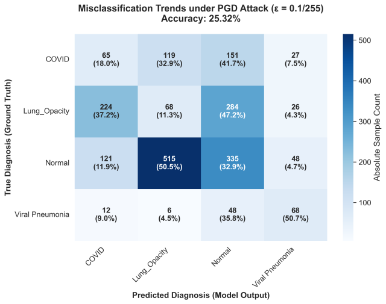

# Model Comparison: Original vs. FGSM vs. PGD ($\epsilon = 0.1/255$)

This section presents the quantitative performance comparison between the unperturbed (*Original*) test set and the **FGSM**- and **PGD**-perturbed test sets at the critical sub-pixel bound $\epsilon = 0.1/255$ ($\approx 0.000392$ in $[0, 1]$), corresponding to **Tables 2, 3, and 4 of the JEEEMI article**.

---

## 1. Per-Class Metric Comparison & F1-Score Degradation (Table 2 in JEEEMI)

| Diagnostic Category | Metric | Original (Clean) | FGSM Attack ($\epsilon = 0.1/255$) | PGD Attack ($\epsilon = 0.1/255$) |
|:--------------------|:-------|:----------------:|:----------------------------------:|:---------------------------------:|
| **COVID-19** ($N = 362$) | Precision Recall **F1-Score** | $0.9914$ $0.9586$ **0.9747** | $0.4844$ $0.5138$ **0.4987** ($\downarrow \mathbf{48.83\%}$) | $0.1540$ $0.1796$ **0.1658** ($\downarrow \mathbf{82.99\%}$) |
| **Lung Opacity** ($N = 602$) | Precision Recall **F1-Score** | $0.9566$ $0.9153$ **0.9355** | $0.4576$ $0.4568$ **0.4572** ($\downarrow \mathbf{51.13\%}$) | $0.0960$ $0.1130$ **0.1038** ($\downarrow \mathbf{88.90\%}$) |
| **Normal** ($N = 1,019$) | Precision Recall **F1-Score** | $0.9368$ $0.9745$ **0.9553** | $0.6989$ $0.6742$ **0.6863** ($\downarrow \mathbf{28.16\%}$) | $0.4095$ $0.3288$ **0.3647** ($\downarrow \mathbf{61.82\%}$) |
| **Viral Pneumonia** ($N = 134$) | Precision Recall **F1-Score** | $0.9847$ $0.9627$ **0.9736** | $0.7181$ $0.7985$ **0.7562** ($\downarrow \mathbf{22.33\%}$) | $0.4024$ $0.5075$ **0.4488** ($\downarrow \mathbf{53.91\%}$) |
| **Overall ($N=2,117$)** | **Accuracy** | **95.42%** | **59.28%** | **25.32%** |

---

## 2. ASR, Prediction Confidence & Statistical Significance (Tables 3 & 4 in JEEEMI)

| Dataset / Attack Type | Epsilon ($\epsilon$) | Accuracy (%) | 95% Confidence Interval | Attack Success Rate (ASR %) | Avg. Confidence (%) | McNemar's Test vs. Clean |
|:----------------------|:--------------------:|:------------:|:-----------------------:|:---------------------------:|:-------------------:|:------------------------:|
| **Original (Clean)** | $0$ | **95.42%** | $94.53\% - 96.31\%$ | — | **96.05%** | — |
| **FGSM (Single-Step)** | $0.1/255$ (`0.000392`) | **59.28%** | $57.19\% - 61.37\%$ | **40.72%** | **82.16%** | $\chi^2 = 763.00 \ (p \ll 0.001)$ |
| **PGD (Iterative, $N=10$)** | $0.1/255$ (`0.000392`) | **25.32%** | $23.42\% - 27.12\%$ | **74.68%** | **85.42%** | $\chi^2 = 1483.00 \ (p \ll 0.001)$ |

!!! danger "Systemic Confidence-Accuracy Misalignment"
    Analysis of the **Avg. Confidence (%)** column in Table 4 reveals a critical operational hazard:
    
    - While PGD reduces global classification accuracy to **25.32%** (equivalent to four-class random guessing), the model maintains an average softmax confidence of **85.42%** (exceeding FGSM's 82.16% confidence).
    - Iterative PGD optimization pushes perturbed inputs deep into erroneous decision regions, causing the network to issue false diagnoses with high certainty.

---

## 3. Visual Comparison of Confusion Matrices & Sample Predictions ($\epsilon = 0.1/255$)

=== "FGSM Confusion Matrix Detail (Fig. 7)"

    {: .center width="580" }

*Figure: Figure 1 (Fig. 7 in JEEEMI): Confusion Matrix detailing misclassification trends under FGSM ($\epsilon=0.1/255$, Accuracy = 59.28%) with absolute sample counts and class-normalized percentages.*

=== "PGD Confusion Matrix Detail (Fig. 8)"

    {: .center width="580" }

*Figure: Figure 2 (Fig. 8 in JEEEMI): Confusion Matrix detailing misclassification trends under PGD ($\epsilon=0.1/255$, Accuracy = 25.32%), illustrating near-total collapse in Lung Opacity (11.3% correct) and COVID-19 (18.0% correct).*

=== "Side-by-Side CM FGSM vs. PGD"

    {: .center width="820" }

*Figure: Figure 3: Side-by-side comparison of FGSM (left) and PGD (right) Confusion Matrices at $\epsilon = 0.1/255$.*

=== "Visual Prediction Samples Clean vs. FGSM vs. PGD"

    _0.1.png){: .center width="750" }

*Figure: Figure 4: Visual comparison of 4 test samples across Clean, FGSM ($\epsilon=0.1/255$), and PGD ($\epsilon=0.1/255$) conditions. Perturbed scans remain visually indistinguishable from clean scans while inducing high-confidence misclassifications.*

---

[:octicons-arrow-right-24: Continue to Sub-Pixel Sensitivity & Robustness Profiles](attack-results.md){ .md-button .md-button--primary }
